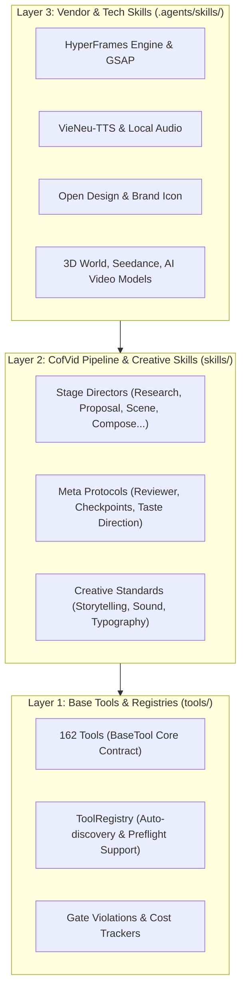
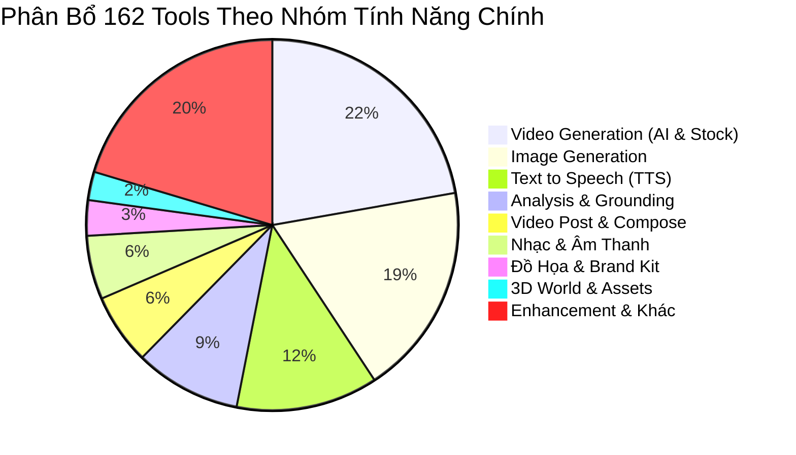

# TÀI LIỆU PHÂN TÍCH TOÀN DIỆN KIẾN TRÚC HỆ THỐNG COFVID
### *Hệ Thống Sản Xuất Video Đa Tác Vụ Tự Động Hóa Bằng AI Agent (State Machine & Pipeline Engine)*

---

## MỤC LỤC
1. [Tổng Quan Kiến Trúc 3 Tầng (3-Layer Architecture)](#1-tổng-quan-kiến-trúc-3-tầng-3-layer-architecture)
2. [Quy Trình State Machine 7 Công Đoạn Tiêu Chuẩn](#2-quy-trình-state-machine-7-công-đoạn-tiêu-chuẩn)
3. [Danh Mục & Phân Tích 13 Pipeline Templates (`pipeline_defs/`)](#3-danh-mục--phân-tích-13-pipeline-templates-pipeline_defs)
4. [Bản Đồ Năng Lực 162 Tools & 27 Nhóm Capability (`tools/`)](#4-bản-đồ-năng-lực-162-tools--27-nhóm-capability-tools)
5. [Hệ Thống Skills Đa Phân Tầng: Nghiệp Vụ & Công Nghệ](#5-hệ-thống-skills-đa-phân-tầng-nghiệp-vụ--công-nghệ)
6. [Bảng Ma Trận Ánh Xạ: Stage ⟷ Tool ⟷ Skill ⟷ Artifact](#6-bảng-ma-trận-ánh-xạ-stage--tool--skill--artifact)
7. [Các Nguyên Tắc & Hướng Dẫn Vận Hành Bắt Buộc Dành Cho AI Agent](#7-các-nguyên-tắc--hướng-dẫn-vận-hành-bắt-buộc-dành-cho-ai-agent)
8. [Phụ Lục A: Danh Mục Toàn Bộ 162 Tools Trong CofVid Tool Registry](#phụ-lục-a-danh-mục-162-tools-trong-cofvid-tool-registry)
9. [Phụ Lục B: Danh Mục Toàn Bộ 96 Skills Trong ](#phụ-lục-b-danh-mục-96-skills-trong-agentsskills)

---

## 1. TỔNG QUAN KIẾN TRÚC 3 TẦNG (3-LAYER ARCHITECTURE)

Hệ thống **CofVid** (Coffee Video Production) là một nền tảng sản xuất video tự động hóa xây dựng theo mô hình **Instruction-Driven Pipeline & State Machine**, lấy AI Agent làm Tổng Đạo Diễn / Tổng Điều Phối (Lead Orchestrator). 

Khác biệt với các hệ thống AI làm video đơn giản (chỉ ghép prompt vào API), CofVid phân tách toàn bộ tri thức và năng lực thành **3 tầng độc lập**:



- **Layer 1: Tools (`tools/`) — Tầng Năng Lực Kỹ Thuật (Capability)**:
  - Gồm 162 tool được kế thừa từ lớp trừu tượng `BaseTool`.
  - Tự động quản lý vòng đời, cơ chế cache tài nguyên, phát sinh sự kiện giám sát Backlot (`events.jsonl`) và chốt chặn an toàn `check_asset_tool_gate`.
  - Khám phá tự động qua `tool_registry.py`.
- **Layer 2: Pipeline & Creative Skills (`skills/`) — Tầng Nghiệp Vụ Đạo Diễn (Business Logic)**:
  - Gồm 144 tài liệu nghiệp vụ đóng vai trò là "chỉ dẫn công việc" cho Agent.
  - Phân thành các **Stage Directors** (đạo diễn từng công đoạn), **Meta Protocols** (giao thức đánh giá, lưu checkpoint) và **Creative Guides** (chuẩn mực thẩm mỹ, kể chuyện).
- **Layer 3: Vendor / Tech Skills (`.agents/skills/`) — Tầng Tri Thức Chuyên Sâu Công Nghệ**:
  - Gồm 96 tài liệu hướng dẫn kỹ thuật chi tiết: cú pháp prompt cho từng model (Seedance 2.5, Kling, Grok, FLUX), cấu trúc code HyperFrames/GSAP, quy tắc 12 nguyên lý hoạt họa Disney, và các thư viện chuyên dụng.

---

## 2. QUY TRÌNH STATE MACHINE 7 CÔNG ĐOẠN TIÊU CHUẨN

Theo quy chuẩn tối cao trong `AGENT_GUIDE.md`, mọi hoạt động sản xuất video đều phải tuần tự đi qua cỗ máy trạng thái 7 công đoạn (kèm 1 stage xuất bản mở rộng):


### Chi Tiết Từng Công Đoạn (Stage Breakdown)

#### Stage 1: `research` (Nghiên cứu & Xác thực Dữ liệu)
- **Mục tiêu**: Khảo sát bối cảnh, thu thập tài nguyên, tìm góc tiếp cận độc đáo và khắc phục triệt để hiện tượng AI bịa đặt thông tin.
- **Nghiệp vụ bắt buộc**: Đối với video tài liệu/công nghệ, bắt buộc chạy `web_data_grounder` để ghi nhận các số liệu có thể kiểm chứng (GitHub stars, năm phát hành, benchmark) vào `grounded_facts.json`.
- **Artifact đầu ra**: `research_brief.json` (hoặc `brief.json`).

#### Stage 2: `proposal` (Đề xuất Ý Tưởng & Dự Toán Chi Phí) — **[HARD GATE]**
- **Mục tiêu**: Đóng gói ý tưởng thành ít nhất 3 concept tương phản, dự toán ngân sách và xác định runtime dựng hình.
- **Nghiệp vụ bắt buộc**: Agent phải chốt đủ **7 Quyết Định Cốt Lõi** vào `decision_log.json`.
- **Giao thức Gate**: Ghi `checkpoint_proposal.json` với `status: "awaiting_human"`, trình bày tóm tắt cho người dùng và **DỪNG LƯỢT NGAY LẬP TỨC (End Turn)**. Cấm sinh asset trước khi người dùng duyệt.
- **Artifact đầu ra**: `proposal_packet.json`, `decision_log.json`.

#### Stage 3: `script` (Biên Soạn Kịch Bản)
- **Mục tiêu**: Viết lời bình dẫn dắt hoàn chỉnh theo cấu trúc Hook (3s đầu) - Body - Climax - Call to Action.
- **Nghiệp vụ bắt buộc**: Tính toán tốc độ đọc (pacing) trung bình 2.5 - 3.2 từ/giây (tiếng Việt), tích hợp các sự thật đã được ground ở Stage 1.
- **Artifact đầu ra**: `script.json`.

#### Stage 4: `scene_plan` (Lập Storyboard & Phân Cảnh) — **[HARD GATE]**
- **Mục tiêu**: Chia nhỏ kịch bản thành từng cảnh (scene) chi tiết theo dòng thời gian (mỗi cảnh thường 3-6s). Xác định visual layer, transition, b-roll keyword và graphic card.
- **Giao thức Gate**: Đây là **Hard Gate quan trọng nhất**. Ghi `checkpoint_scene_plan.json` với `status: "awaiting_human"`. Hàm `check_asset_tool_gate` tại tầng `BaseTool` sẽ khóa cứng mọi tool TTS/Video/Image nếu checkpoint này chưa có `human_approved=True`.
- **Artifact đầu ra**: `scene_plan.json`.

#### Stage 5: `assets` (Tạo & Thu Thập Tài Nguyên Media)
- **Mục tiêu**: Tạo toàn bộ media theo đặc tả của `scene_plan`.
- **Nghiệp vụ bắt buộc**:
  - Voiceover: Chạy `vieneu_tts` (offline, 0$, giọng Hải Đăng/Mai Anh).
  - Brand Icons: Dùng `brand_icon_tool` lấy SVG chính hãng, cấm AI vẽ logo.
  - Graphic Cards: Dùng `open_design_tool` tạo Chapter Card / Stat Callout trong suốt (alpha overlay).
  - B-roll: Ưu tiên stock miễn phí từ Coverr/Mixkit hoặc Pixabay trước khi gọi AI Video models.
- **Giao thức Gate**: **Storyboard Review Gate** — Người dùng xem filmstrip tổng quan trước khi dựng.
- **Artifact đầu ra**: `asset_manifest.json`.

#### Stage 6: `edit` (Dựng Dòng Thời Gian & Cắt Ghép Âm Thanh)
- **Mục tiêu**: Quyết định chính xác thời điểm xuất hiện của từng video clip, canh nhịp chuyển cảnh theo phách nhạc (beat grid), cấu hình hạ nhạc nền khi có lời nói (Audio Ducking) và chuẩn hóa âm thanh chuẩn EBU R128 (-14 LUFS).
- **Artifact đầu ra**: `edit_decisions.json`.

#### Stage 7: `compose` (Lắp Ráp Mã Nguồn & Render Video)
- **Mục tiêu**: Lắp ráp mã nguồn vào runtime tương ứng và render ra file video deliverable hoàn chỉnh (`renders/final.mp4`).
- **Nghiệp vụ bắt buộc**:
  - Ưu tiên số 1: **HyperFrames** (HTML/CSS/GSAP) theo phong cách **Atelier Mode** (Hand-authored code).
  - Lựa chọn 2: **Remotion** (React) khi cần các hiệu ứng phức tạp hoặc Talking Head.
  - Review chất lượng video cuối cùng bằng checklist CHAI.
- **Artifact đầu ra**: `render_report.json`, `final_review.json`, `final.mp4`.

#### Stage 8: `publish` (Đóng Gói & Tối Ưu Phân Phối - Tùy chọn)
- **Mục tiêu**: Đóng gói video bundle, tạo tiêu đề thu hút, mô tả video, hashtags, và concept ảnh thumbnail.
- **Artifact đầu ra**: `publish_log.json`.

---

## 3. DANH MỤC & PHÂN TÍCH 13 PIPELINE TEMPLATES (`pipeline_defs/`)

Hệ thống cung cấp 13 template định nghĩa sẵn dưới dạng declarative YAML trong thư mục `pipeline_defs/`.

| Tên Pipeline (`.yaml`) | Các Stage Trong Luồng | Mục Đích & Bối Cảnh Ứng Dụng | Mức Độ Hoàn Thiện |
|:---|:---|:---|:---:|
| **1. `animated-explainer.yaml`** | `research` ➔ `proposal` ➔ `script` ➔ `scene_plan` ➔ `assets` ➔ `edit` ➔ `compose` ➔ `publish` | **Quy chuẩn cao cấp nhất**: Giải thích chủ đề chuyên sâu từ nghiên cứu thực tế, đồ họa chuyển động bento, lời bình và nhạc nền. | Production |
| **2. `animation.yaml`** | `research` ➔ `proposal` ➔ `script` ➔ `scene_plan` ➔ `assets` ➔ `edit` ➔ `compose` ➔ `publish` | Chuyên sâu về Motion Graphics, Kinetic Typography, sơ đồ khoa học (Manim) và mô hình không gian Three.js. | Production |
| **3. `avatar-spokesperson.yaml`** | `idea` ➔ `script` ➔ `scene_plan` ➔ `assets` ➔ `edit` ➔ `compose` ➔ `publish` | Video có MC ảo (Avatar HeyGen, Kling Talking Head) dẫn chuyện, phục vụ đào tạo nội bộ, sales demo. | Production |
| **4. `cinematic.yaml`** | `research` ➔ `proposal` ➔ `script` ➔ `scene_plan` ➔ `assets` ➔ `edit` ➔ `compose` ➔ `publish` | Trailer phim, teaser, clip điện ảnh nhịp điệu dồn dập, hiệu ứng âm thanh sống động (SFX) kết hợp cảnh AI chất lượng cao. | Production |
| **5. `screen-demo.yaml`** | `idea` ➔ `script` ➔ `scene_plan` ➔ `assets` ➔ `edit` ➔ `compose` ➔ `publish` | Video giới thiệu sản phẩm phần mềm/lập trình: quay thao tác màn hình thật (Playwright) hoặc giả lập terminal (TerminalScene). | Production |
| **6. `hybrid.yaml`** | `idea` ➔ `script` ➔ `scene_plan` ➔ `assets` ➔ `edit` ➔ `compose` ➔ `publish` | Kết hợp linh hoạt giữa video có sẵn của người dùng với các đoạn đồ họa và b-roll AI sinh thêm. | Production |
| **7. `character-animation.yaml`** | `research` ➔ `proposal` ➔ `script` ➔ `character_design` ➔ `rig_plan` ➔ `scene_plan` ➔ `assets` ➔ `edit` ➔ `compose` ➔ `publish` | Hoạt hình nhân vật 2D độc lập: thiết kế SVG Rig, thư viện tư thế (pose library) và ghép chuyển động cục bộ, không tốn API. | Beta |
| **8. `clip-factory.yaml`** | `idea` ➔ `script` ➔ `scene_plan` ➔ `assets` ➔ `edit` ➔ `compose` ➔ `publish` | Nhà máy sản xuất clip ngắn: trích xuất các khoảnh khắc "viral" từ video nguồn dài (podcast, talkshow) thành 9:16 Shorts/Reels. | Beta |
| **9. `documentary-montage.yaml`** | `idea` ➔ `scene_plan` ➔ `assets` ➔ `edit` ➔ `compose` | Phim phóng sự lịch sử/tài liệu: tự động tìm kiếm tư liệu lưu trữ từ Archive.org, Prelinger và kho stock tư liệu thực tế. | Beta |
| **10. `talking-head.yaml`** | `idea` ➔ `script` ➔ `scene_plan` ➔ `assets` ➔ `edit` ➔ `compose` ➔ `publish` | Tự động hóa khâu hậu kỳ video người thật: cắt khoảng lặng (`silence_cutter`), tự căn khung 9:16 (`auto_reframe`) và dán phụ đề. | Beta |
| **11. `podcast-repurpose.yaml`** | `idea` ➔ `script` ➔ `scene_plan` ➔ `assets` ➔ `edit` ➔ `compose` ➔ `publish` | Biến đổi tập podcast âm thanh thành video dạng audiogram (sóng âm) kèm các thẻ trích dẫn phát biểu ấn tượng. | Beta |
| **12. `localization-dub.yaml`** | `idea` ➔ `script` ➔ `scene_plan` ➔ `assets` ➔ `edit` ➔ `compose` ➔ `publish` | Bản địa hóa video: dịch kịch bản, lồng tiếng đa ngôn ngữ và đồng bộ khẩu hình (lip-sync). | Beta |
| **13. `framework-smoke.yaml`** | `research` ➔ `script` | Pipeline kiểm thử tinh gọn (Smoke Test) phục vụ việc chạy CI/CD và kiểm tra tích hợp các interface trong hệ thống. | Test |

---

## 4. BẢN ĐỒ NĂNG LỰC 162 TOOLS & 27 NHÓM CAPABILITY (`tools/`)

Toàn bộ **162 tools** được quản lý tập trung qua `ToolRegistry` và kế thừa từ lớp `BaseTool`.



### 1. Chi Tiết 27 Nhóm Năng Lực (Capability Families)

| STT | Nhóm Năng Lực (Capability) | Số Lượng | Tools Đại Diện Tiêu Biểu | Chức Năng Cốt Lõi |
|:---:|:---|:---:|:---|:---|
| 1 | `tts` | 20 | `vieneu_tts`, `piper_tts`, `tts_selector`, `elevenlabs_tts`, `azure_tts`, `doubao_tts` | Tổng hợp giọng đọc nhân tạo. Mặc định dùng `vieneu_tts` (offline, 0$). |
| 2 | `video_generation` | 36 | `coverr_video`, `mixkit_video`, `pixabay_video`, `video_selector`, `seedance_video`, `kling_video`, `wan_video` | Thu thập footage từ kho stock miễn phí hoặc sinh video clip bằng mô hình diffusion. |
| 3 | `video_post` | 10 | `video_compose`, `hyperframes_compose`, `video_stitch`, `auto_reframe`, `silence_cutter` | Dàn dựng video hoàn chỉnh, cắt ghép, chuyển đổi tỷ lệ khung hình, loại bỏ khoảng lặng. |
| 4 | `image_generation` | 30 | `pixabay_image`, `image_selector`, `google_imagen`, `bfl_image`, `flux_image`, `grok_image` | Tìm kiếm ảnh stock chất lượng cao hoặc sinh ảnh AI phục vụ storyboard và visual layers. |
| 5 | `graphics` | 5 | `open_design_tool`, `brand_icon_tool`, `math_animate`, `diagram_gen`, `code_snippet` | Đồ họa xuất bản Anti-AI Slop: Thẻ tiêu đề, thẻ số liệu, logo vector thương hiệu chính hãng, code snippet. |
| 6 | `analysis` | 15 | `web_data_grounder`, `transcriber`, `video_analyzer`, `visual_qa`, `scene_detect`, `audio_probe` | Cào dữ liệu thực tế chống ảo giác, bóc tách phụ đề kèm timestamp từng từ, phân tích chất lượng video. |
| 7 | `audio_processing` | 2 | `audio_mixer`, `audio_enhance` | Hòa trộn đa kênh âm thanh (voice, BGM, SFX), thực hiện Audio Ducking và chuẩn hóa chuẩn EBU R128 (-14 LUFS). |
| 8 | `music_generation` | 6 | `music_gen`, `google_music`, `suno_music`, `comfyui_music` | Sáng tác nhạc nền AI theo phong cách và độ dài cụ thể. |
| 9 | `music_search` | 2 | `pixabay_music`, `freesound` | Tìm kiếm bài nhạc và hiệu ứng âm thanh miễn phí bản quyền. |
| 10 | `music_library` | 1 | `music_library` | Truy xuất kho nhạc tuyển chọn cục bộ của CofVid theo cảm xúc (mood) và thể loại. |
| 11 | `avatar` | 5 | `heygen_avatar`, `talking_head`, `lip_sync`, `kling_avatar` | Tạo người dẫn ảo nói theo kịch bản và đồng bộ khẩu hình khuôn mặt. |
| 12 | `character_animation` | 6 | `svg_rig_builder`, `pose_library_builder`, `action_timeline_compiler` | Tạo và điều khiển cử động nhân vật 2D dạng vector cục bộ. |
| 13 | `3d_world_generation` | 1 | `threejs_world` | Tạo thế giới 3D đa góc nhìn bằng Three.js theo mô tả ngôn ngữ tự nhiên. |
| 14 | `3d_world_rendering` | 1 | `blender_world` | Render cảnh 3D độ nét cao bằng Blender không cần mở giao diện đồ họa (headless). |
| 15 | `3d_asset_generation` | 2 | `atlas_3d`, `fal_3d` | Tạo mô hình 3D (.glb/.gltf) từ hình ảnh hoặc văn bản qua gateway API. |
| 16 | `3d_asset_acquisition` | 1 | `threejs_asset_catalog` | Tải các tài nguyên 3D có sẵn từ thư viện mã nguồn mở. |
| 17 | `subtitle` | 2 | `subtitle_gen`, `caption_burn` | Tạo file phụ đề SRT/VTT và ghi đè (burn) trực tiếp phụ đề động vào video. |
| 18 | `enhancement` | 6 | `bg_remove`, `color_grade`, `face_restore`, `upscale`, `frame_interpolate` | Xóa nền video, áp bảng màu LUT, phục hồi nét mặt và nâng độ phân giải. |
| 19 | `screen_capture` | 3 | `cap_recorder`, `screen_record`, `browser_session` | Tự động hóa trình duyệt Playwright để quay video màn hình thực tế. |
| 20 | `source_ingest` | 1 | `video_downloader` | Tải video và audio từ hơn 1000 nền tảng mạng xã hội qua yt-dlp. |
| 21 | `clip_retrieval` | 1 | `clip_search` | Tìm kiếm clip liên quan theo nội dung ngữ nghĩa trong kho lưu trữ. |
| 22 | `clip_acquisition` | 1 | `direct_clip_search` | Tìm và tải trực tiếp đoạn video mẫu theo từ khóa cụ thể. |
| 23 | `corpus_population` | 1 | `corpus_builder` | Xây dựng kho ngữ liệu video phục vụ huấn luyện hoặc dựng phim. |
| 24 | `voice_conversion` | 1 | `heygen_voice_convert` | Chuyển đổi âm sắc giọng nói người này thành người khác. |
| 25 | `publish` | 1 | `export_bundle` | Đóng gói video hoàn thiện, tài liệu kèm theo, thumbnail và metadata. |
| 26 | `realtime_audio` | 1 | `realtime_audio` | Giao tiếp âm thanh hai chiều trực tiếp phục vụ tương tác thời gian thực. |
| 27 | `llm_bridge` | 1 | `gemini_desktop_bridge` | Kết nối với mô hình LLM cục bộ miễn phí trên máy tính để phân tích. |

### 2. Các Tool Trọng Yếu Cần Nắm Rõ Chi Tiết

#### `tools.video.video_compose` (`VideoCompose`)
- **Vai trò**: Trái tim dàn dựng của toàn bộ hệ thống.
- **Tham số đầu vào**:
  - `edit_decisions` (dict): Danh sách các quyết định dựng (cảnh, thời lượng, vị trí asset, ducking).
  - `output_path` (str): Đường dẫn lưu file MP4 cuối cùng.
  - `render_runtime` ("hyperframes" | "remotion" | "ffmpeg"): Engine render được chỉ định.
  - `composition_mode` ("atelier" | "templated"): Chế độ viết code thủ công hay lắp ghép mẫu có sẵn.
- **Cơ chế hoạt động**: Khi nhận `render_runtime="hyperframes"`, tool biên dịch cấu trúc cảnh thành tài liệu HTML/CSS/GSAP tuân thủ tiêu chuẩn HyperFrames rồi gọi headless browser của `npx hyperframes render` để kết xuất video MP4 mượt mà từng khung hình.

#### `tools.audio.vieneu_tts` (`VieneuTTS`)
- **Vai trò**: Bộ tổng hợp giọng nói tiếng Việt mặc định số 1.
- **Ưu điểm**: Chạy hoàn toàn offline qua ONNX Runtime trên vi xử lý Apple Silicon hoặc CPU thông thường. Chi phí **0 USD**, bảo mật 100%, chất giọng tự nhiên đạt chuẩn phát thanh.
- **Tham số**: `text` (văn bản), `voice` ("hai_dang" - nam miền Bắc trầm ấm / "mai_anh" - nữ miền Bắc truyền cảm), `speed` (tốc độ đọc), `output_path`.

#### `tools.graphics.open_design_tool` (`OpenDesignTool`)
- **Vai trò**: Cốt lõi của triết lý **Anti-AI Slop** trong CofVid.
- **Nguyên lý**: Thay vì để AI vẽ toàn bộ màn hình một cách vô hồn, tool sinh ra các thẻ đồ họa xuất bản mang phong cách báo chí cao cấp (Neo-Brutalist, Swiss Editorial, Tactile Bento) dưới dạng file ảnh trong suốt (PNG với alpha channel) hoặc đoạn video motion graphics để chèn vào video, tạo nhịp nghỉ cho thị giác.
- **Loại thẻ**: Chapter Title Card (báo hiệu đổi phần), Monumental Stat Callout (nhấn mạnh con số ấn tượng), Quote Card (trích dẫn nhân vật).

#### `tools.graphics.brand_icon_tool` (`BrandIconTool`)
- **Vai trò**: Bảo vệ thương hiệu, loại bỏ hoàn toàn lỗi méo logo của các mô hình sinh ảnh AI.
- **Nguyên lý**: Trích xuất trực tiếp file vector SVG nguyên gốc từ thư viện Simple Icons và website chính thức của các tổ chức (GitHub, Docker, Google, Python...). Đảm bảo độ sắc nét tuyệt đối ở mọi kích thước hiển thị.

#### `tools.analysis.web_data_grounder` (`WebDataGrounderTool`)
- **Vai trò**: Đảm bảo tính xác thực cho các video tài liệu, explainer.
- **Đầu ra bắt buộc**: File `grounded_facts.json` chứa các cặp giá trị được xác minh từ live web hoặc GitHub API. Mọi thông số xuất hiện trên màn hình đều phải có nguồn gốc từ file này.

---

## 5. HỆ THỐNG SKILLS ĐA PHÂN TẦNG: NGHIỆP VỤ & CÔNG NGHỆ

### 1. Phân Loại Skills Nghiệp Vụ (`skills/` - 144 Files)

```
skills/
├── core/                  # Các kỹ thuật nền tảng: hyperframes, remotion, ffmpeg, color-grading...
├── meta/                  # Các quy chuẩn điều phối: onboarding, checkpoint-protocol, reviewer, taste-direction...
├── creative/              # Hướng dẫn nghệ thuật: storytelling, sound-design, typography, data-viz, prompting/...
└── pipelines/             # Stage Directors riêng cho từng pipeline
    ├── animated-explainer/
    ├── cinematic/
    ├── avatar-spokesperson/
    └── ...
```

#### Các Stage Directors Cốt Lõi (Đạo Diễn Công Đoạn)
- **`executive-producer.md`**: Giám sát bao quát dự án, kiểm soát ngân sách, điều phối sự chuyển tiếp giữa các công đoạn và bảo đảm tính nhất quán của tầm nhìn nghệ thuật.
- **`research-director.md`**: Chỉ đạo chiến lược thu thập dữ liệu qua 5 vòng tìm kiếm thông tin, phát hiện các góc nhìn bất ngờ chưa ai khai thác và ground số liệu.
- **`proposal-director.md`**: Hướng dẫn đóng gói 3 concept sáng tạo, lập bảng dự toán chi phí chi tiết từng công đoạn, và chuẩn bị tài liệu xin duyệt tại Proposal Gate.
- **`script-director.md`**: Hướng dẫn kỹ thuật viết kịch bản đa giác quan: 3 giây đầu giữ chân khán giả, chia nhỏ câu chữ theo nhịp thở tự nhiên của người thuyết minh.
- **`scene-director.md`**: Định hướng chuyển thể từ câu chữ sang thị giác: phân bổ nhịp độ cảnh (pacing), phối hợp các lớp đồ họa Open Design và chuyển động camera.
- **`asset-director.md`**: Điều phối việc thu thập và tạo media: lựa chọn giọng đọc phù hợp, trích xuất vector logo sạch, lấy stock footage không bản quyền.
- **`edit-director.md`**: Chỉ đạo cắt dựng: thiết lập đường trục thời gian, canh phách âm nhạc, áp dụng công thức Audio Ducking chuyên nghiệp.
- **`compose-director.md`**: Chỉ đạo việc lắp ráp mã nguồn HyperFrames hoặc Remotion, áp dụng quy chuẩn kiểm thử CHAI trước khi bàn giao.

#### Các Meta Skills Quan Trọng
- **`checkpoint-protocol.md`**: Quy định chuẩn về lưu trữ trạng thái công việc (`in_progress`, `awaiting_human`, `completed`), cách xử lý khi quy trình bị gián đoạn và tự động lưu trữ lịch sử sửa đổi (`history/`).
- **`reviewer.md`**: Bộ quy tắc tự đánh giá sản phẩm của AI theo tiêu chuẩn **CHAI**:
  - *Comprehensive*: Đầy đủ tất cả các phân cảnh, không cắt xén.
  - *Human-centered*: Dễ xem, an toàn cho mắt, không gây chóng mặt.
  - *Accurate*: Thông tin và số liệu khớp 100% với tài liệu research.
  - *Insightful*: Có điểm nhấn tư duy, không sao chép máy móc.
- **`taste-direction.md`**: Định hình phong cách thẩm mỹ: hướng tới sự tinh tế, tối giản, sang trọng, bài trừ hoàn toàn các chi tiết màu mè lòe loẹt mang tính chất "AI rác" (AI Slop).
- **`bespoke-composition.md`**: Tiêu chuẩn chế tác giao diện theo chế độ **Atelier Mode** — tự tay viết các đoạn mã CSS/GSAP độc bản cho từng video.

### 2. Danh Mục Skills Công Nghệ Chuyên Sâu (`.agents/skills/` - 96 Skills)

Các kỹ năng này cung cấp bí quyết lập trình và cấu trúc prompt cụ thể:
- **Bộ Công Cụ HyperFrames**: `hyperframes`, `hyperframes-core`, `hyperframes-animation`, `hyperframes-creative`, `hyperframes-media`, `hyperframes-cli`, `hyperframes-registry`.
- **Hoạt Họa & Chuyển Động Web**: `gsap-core`, `gsap-timeline`, `gsap-plugins`, `gsap-react`, `gsap-scrolltrigger`, `framer-motion`, `lottie-bodymovin`.
- **Không Gian 3D**: `threejs-world-generation`, `threejs-fundamentals`, `threejs-animation`, `threejs-materials`, `threejs-lighting`.
- **Toán Học & Khoa Học**: `manimce-best-practices`, `manimgl-best-practices`, `manim-composer`, `beautiful-mermaid`, `d3-viz`.
- **Giọng Nói & Âm Thanh**: `vieneu-tts`, `azure-text-to-speech`, `azure-speech-to-text`, `doubao-tts`, `fish-audio-tts`, `elevenlabs`, `sound-effects`.
- **Mô Hình Video AI Thế Hệ Mới**: `seedance-2-0`, `seedance-2-5`, `kling-official`, `minimax-h3`, `ltx2`, `ai-video-gen`.
- **Bản Sắc Kênh Độc Quyền**: `coffat-media-director` (Chỉ đạo nghệ thuật cho 5 kênh dọc: Mạch Số, Vạn Vật, Dấu Mốc, Tâm Trí, Bàn Cờ).

---

## 6. BẢNG MA TRẬN ÁNH XẠ: STAGE ⟷ TOOL ⟷ SKILL ⟷ ARTIFACT

Dưới đây là bảng đối chiếu tổng thể toàn bộ chuỗi sản xuất của một video tiêu chuẩn:

| CÔNG ĐOẠN (STAGE) | NHIỆM VỤ CHÍNH | CÁC TOOLS ĐƯỢC PHÉP DÙNG | SKILLS NGHIỆP VỤ (LAYER 2) | SKILLS CÔNG NGHỆ (LAYER 3) | CANONICAL ARTIFACT | CHỐT CHẶN (GATE) |
|:---|:---|:---|:---|:---|:---|:---:|
| **1. Research** | Khảo sát đề tài, tìm khoảng trống nội dung, cào số liệu thực tế | `web_data_grounder`, `video_downloader`, `transcript_fetcher`, `video_analyzer` | `research-director.md`, `creative-intake.md` | `web-data-grounding` | `research_brief.json`, `grounded_facts.json` | Tự do |
| **2. Proposal** | Thiết kế ≥3 concept tương phản, tính toán ngân sách, chọn runtime | `cost_tracker`, `video_compose` (kiểm tra runtime) | `proposal-director.md`, `taste-direction.md`, `animation-runtime-selector.md` | `hyperframes`, `remotion` | `proposal_packet.json`, `decision_log.json` | **HARD GATE**<br/>*(Bắt buộc dừng lượt)* |
| **3. Script** | Soạn thảo kịch bản hoàn chỉnh, căn chỉnh tốc độ đọc (pacing) | Không dùng tool (hoặc `transcriber` nếu tái chế video cũ) | `script-director.md`, `storytelling.md` | — | `script.json` | Tùy pipeline |
| **4. Scene Plan** | Lập storyboard từng giây, gán vị trí graphic card, mô tả b-roll | Không dùng tool (hoặc `frame_sampler` khi phân tích mẫu) | `scene-director.md`, `data-visualization.md`, `broll-planning.md` | `open-design`, `brand-icon` | `scene_plan.json` | **HARD GATE**<br/>*(Bắt buộc dừng lượt)* |
| **5. Assets** | Thu âm voiceover, lấy vector logo, tạo card đồ họa, lấy footage | `vieneu_tts`, `tts_selector`, `brand_icon_tool`, `open_design_tool`, `coverr_video`, `mixkit_video`, `pixabay_image`, `music_gen` | `asset-director.md`, `sound-design.md`, `typography.md`, `stock-sourcing-usage.md` | `vieneu-tts`, `brand-icon`, `open-design`, `hyperframes-media` | `asset_manifest.json` | **Storyboard Gate**<br/>*(Duyệt filmstrip)* |
| **6. Edit** | Xác lập timeline, cấu hình Audio Ducking (-14 LUFS), đồng bộ phụ đề | `silence_cutter`, `video_trimmer`, `audio_enhance` | `edit-director.md`, `video-editing.md`, `subtitle-sync.md` | `ffmpeg`, `video-toolkit` | `edit_decisions.json` | Tự do |
| **7. Compose** | Lắp ráp mã nguồn HTML/CSS/GSAP, render video MP4 hoàn thiện | `video_compose`, `hyperframes_compose`, `audio_mixer`, `video_stitch` | `compose-director.md`, `bespoke-composition.md`, `reviewer.md` | `hyperframes-core`, `hyperframes-animation`, `gsap-core`, `remotion-best-practices` | `render_report.json`, `final_review.json`, `renders/final.mp4` | Kiểm thử CHAI |
| **8. Publish** | Đóng gói export bundle, tạo tiêu đề chuẩn SEO, mô tả, thumbnail | `export_bundle` | `publish-director.md` | — | `publish_log.json`, `bundle.zip` | Nghiệm thu cuối |

---

## 7. CÁC NGUYÊN TẮC & HƯỚNG DẪN VẬN HÀNH BẮT BUỘC DÀNH CHO AI AGENT

Khi AI Agent nhận lệnh sản xuất video từ người dùng, Agent **PHẢI TUÂN THỦ TUYỆT ĐỐI** các quy định sau:

### 1. Nguyên Tắc Số Không (Rule Zero)
> **Mọi hoạt động sản xuất video BẮT BUỘC phải đi qua cỗ máy trạng thái Pipeline. Không có bất kỳ ngoại lệ nào.**
- **Nghiêm cấm viết script tùy tiện**: Tuyệt đối không được tự ý viết các file script như `generate_artifacts.py` hay `run_pipeline.py` để chạy tắt công đoạn hoặc giả lập kết quả.
- **Nghiêm cấm nhảy cóc**: Không bao giờ được gọi các công cụ sinh media (như `vieneu_tts`, `video_compose`) khi các công đoạn trước đó (`proposal`, `script`, `scene_plan`) chưa được hoàn thành và nghiệm thu hợp lệ.

### 2. Giao Thức Dừng Lượt Tại Cổng Kiểm Soát (Turn-Ending Protocol)
Tại các công đoạn có cờ `human_approval_default: true` (bắt buộc gồm `proposal` và `scene_plan`):
1. Agent ghi file checkpoint tương ứng với `status: "awaiting_human"`.
2. Trình bày ngắn gọn cho người dùng: Bản tóm tắt artifact, nhận xét tự đánh giá của Reviewer, và snapshot chi phí.
3. **KẾT THÚC LƯỢT NGAY LẬP TỨC (END YOUR TURN)**.
4. Tuyệt đối không được vừa gửi câu hỏi vừa gọi công cụ của công đoạn sau trong cùng một lượt.
5. Chỉ khi nhận được phản hồi chấp thuận rõ ràng của người dùng, Agent mới được cập nhật checkpoint thành `status: "completed"` kèm `human_approved: true` và bước tiếp.

### 3. Bảy Quyết Định Bắt Buộc Tại Proposal Gate (`decision_log.json`)
Tại công đoạn `proposal`, Agent bắt buộc phải tổng hợp và ghi nhận đủ 7 quyết định:
1. `approval_policy`: Xác định các cổng phê duyệt cần dừng lại hỏi người dùng.
2. `music_source`: Chỉ định bài nhạc cụ thể từ thư viện `music_library/` hoặc nguồn cung cấp.
3. `voice_selection`: Chọn giọng đọc thuyết minh (mặc định ưu tiên VieNeu-TTS Hải Đăng hoặc Mai Anh).
4. `playbook_selection`: Chọn phong cách hình ảnh (ví dụ: Mạch Số Neo-Brutalist Tactile Bento).
5. `composition_mode`: Chọn chế độ dàn dựng (`atelier` chế tác thủ công chất lượng cao, hoặc `templated` nhanh gọn).
6. `render_runtime_selection`: Lựa chọn engine render (mặc định ưu tiên **HyperFrames**, Remotion đứng thứ hai).
7. `concept_selection`: Chọn 1 concept chính từ ít nhất 3 concept tương phản được đưa ra.

### 4. Các Ràng Buộc Thẩm Mỹ & Kỹ Thuật Bất Khả Xâm Phạm
- **Luật Nhịp Điệu Chống AI Rác (Anti-AI Slop Rhythm Rule)**: Không bao giờ được phép để video ngập tràn toàn bộ bằng các clip hoạt họa do AI sinh ra. Bắt buộc phải đan xen các thẻ đồ họa xuất bản tĩnh/chuyển động tối giản từ `open_design_tool` (ít nhất 1 Chapter Card và 1-2 Stat Callout) để tạo nhịp thở thị giác.
- **Luật Cấm AI Vẽ Logo (No AI Logos Rule)**: Nghiêm cấm dùng mô hình diffusion tạo logo thương hiệu. Toàn bộ logo công nghệ phải trích xuất file vector SVG nguyên bản qua `brand_icon_tool`.
- **Luật Xác Thực Nguồn Số Liệu (Fact-Grounded Sourcing Rule)**: Mọi số liệu thống kê trong kịch bản phải được đối soát qua `web_data_grounder` và ghi nhận trong `grounded_facts.json`. Mọi số liệu không có trong file này đều bị coi là ảo giác và bị từ chối duyệt.
- **Tiêu Chuẩn Giọng Đọc Địa Phương (Local-First Vietnamese Narration)**: Ưu tiên số một cho tiếng Việt là `vieneu_tts` chạy trực tiếp trên máy, vừa tiết kiệm 100% chi phí API, vừa loại trừ rủi ro nghẽn mạng.

# PHỤ LỤC A: DANH MỤC 162 TOOLS TRONG COFVID TOOL REGISTRY

> Tổng hợp đầy đủ 162 tools đã được đăng ký và kiểm định trong `tools/tool_registry.py` của CofVid Framework. Được phân loại thành 12 nhóm chủ đề chức năng mạch lạc kèm định danh Module, Capability, Phân loại runtime (Local/Offline vs Cloud API), và mô tả công năng cốt lõi.

### 01. AI Video Generation & Neural Synthesis (Tạo Video AI) (35 tools)

| STT | Tên Tool (`name`) | Module (`__module__`) | Capability | Phân loại Runtime | Tóm tắt Công năng Chính |
| :---: | :--- | :--- | :--- | :--- | :--- |
| 1 | `atlas_video` | `tools.video.atlas_video` | `video_generation` | Cloud API | Seedance 2.5/2.0 text, image, and mixed-reference video through Atlas Cloud |
| 2 | `cogvideo_video` | `tools.video.cogvideo_video` | `video_generation` | Local GPU (Offline VRAM) | lower-VRAM local video experimentation |
| 3 | `comfyui_video` | `tools.video.comfyui_video` | `video_generation` | Local GPU (Offline VRAM) | local GPU video generation without API costs |
| 4 | `coverr_video` | `tools.video.coverr_video` | `video_generation` | Local (Offline CPU) | modern lifestyle and cinematic B-roll |
| 5 | `flux3_video` | `tools.video.flux3_video` | `video_generation` | Cloud API | Tạo video AI từ văn bản hoặc hình ảnh sử dụng mô hình FLUX qua fal.ai |
| 6 | `gemini_omni_fal` | `tools.video.gemini_omni_fal` | `video_generation` | Cloud API | Gemini Omni Flash with a fal.ai key |
| 7 | `gemini_omni_video` | `tools.video.gemini_omni_video` | `video_generation` | Cloud API | iterative natural-language video editing (edit a clip without regenerating it) |
| 8 | `grok_video` | `tools.video.grok_video` | `video_generation` | Cloud API | cinematic clips with native synchronized audio (dialogue, SFX, music) |
| 9 | `h3_max_video` | `tools.video.h3_max_video` | `video_generation` | Cloud API | Fast H3 Max drafts and final clips with reference control |
| 10 | `heygen_video` | `tools.video.heygen_video` | `video_generation` | Cloud API | Tạo video AI nói chuyện với avatar kỹ thuật số và đồng bộ môi qua HeyGen API |
| 11 | `higgsfield_video` | `tools.video.higgsfield_video` | `video_generation` | Cloud API | preferred premium video gen on Higgsfield (Seedance 2.0 is the default model) |
| 12 | `hunyuan_cloud_video` | `tools.video.hunyuan_cloud_video` | `video_generation` | Cloud API | Tencent Hunyuan cloud video generation via TokenHub API |
| 13 | `hunyuan_video` | `tools.video.hunyuan_video` | `video_generation` | Local GPU (Offline VRAM) | local generation when Hunyuan motion behavior fits the brief |
| 14 | `jimeng_video` | `tools.video.jimeng_video` | `video_generation` | Cloud API | Jimeng 3.0 Pro text-to-video and image-to-video via Volcengine |
| 15 | `kling_official_video` | `tools.video.kling_official_video` | `video_generation` | Cloud API | official Kling direct API access |
| 16 | `kling_video` | `tools.video.kling_video` | `video_generation` | Cloud API | cinematic B-roll with highest visual fidelity |
| 17 | `ltx_api_video` | `tools.video.ltx_api_video` | `video_generation` | Cloud API | LTX-2.5 Fast/Pro direct video at verified resolution and FPS combinations |
| 18 | `ltx_video_local` | `tools.video.ltx_video_local` | `video_generation` | Local GPU (Offline VRAM) | local LTX workflows already tuned around LTX prompting |
| 19 | `ltx_video_modal` | `tools.video.ltx_video_modal` | `video_generation` | Cloud API | self-hosted cloud GPU rendering for LTX without local workstation dependence |
| 20 | `minimax_fal_video` | `tools.video.minimax_fal_video` | `video_generation` | Cloud API | MiniMax H3 through an existing fal.ai account |
| 21 | `minimax_video` | `tools.video.minimax_video` | `video_generation` | Cloud API | 2K text, image, first/last-frame, and reference video generation with MiniMax-H3 |
| 22 | `mixkit_video` | `tools.video.mixkit_video` | `video_generation` | Local (Offline CPU) | high-quality curated B-roll (nature, business, technology, lifestyle) |
| 23 | `pexels_video` | `tools.video.pexels_video` | `video_generation` | Cloud API | real-world B-roll footage (cities, nature, people, offices) |
| 24 | `pixabay_video` | `tools.video.pixabay_video` | `video_generation` | Cloud API | large royalty-free video library |
| 25 | `runway_video` | `tools.video.runway_video` | `video_generation` | Cloud API | Seedance 2.5 clips up to 30 seconds with large multimodal reference sets |
| 26 | `seedance_ark` | `tools.video.seedance_ark` | `video_generation` | Cloud API | Generate Seedance 2.0 video through Volcengine Ark's official REST API |
| 27 | `seedance_replicate` | `tools.video.seedance_replicate` | `video_generation` | Cloud API | preferred premium video gen when REPLICATE_API_TOKEN is available |
| 28 | `seedance_video` | `tools.video.seedance_video` | `video_generation` | Cloud API | preferred premium video gen when FAL_KEY is available |
| 29 | `sora_video` | `tools.video.sora_video` | `video_generation` | Cloud API | OpenAI Sora 2 / Sora 2 Pro clips from the project .env credentials |
| 30 | `veo_video` | `tools.video.veo_video` | `video_generation` | Cloud API | videos with synchronized dialogue and audio |
| 31 | `vidu_video` | `tools.video.vidu_video` | `video_generation` | Cloud API | Tạo video AI cinematic (Image-to-Video, Reference-to-Video) qua Vidu API |
| 32 | `wan_atlas_video` | `tools.video.wan_atlas_video` | `video_generation` | Cloud API | Tạo video AI Wan 2.1 và ESR video thông qua Atlas Cloud gateway |
| 33 | `wan_fal_video` | `tools.video.wan_fal_video` | `video_generation` | Cloud API | Tạo video AI Wan 2.1 thông qua fal.ai cloud gateway |
| 34 | `wan_replicate_video` | `tools.video.wan_replicate_video` | `video_generation` | Cloud API | Tạo video AI Wan 2.1 qua nền tảng đám mây Replicate |
| 35 | `wan_video` | `tools.video.wan_video` | `video_generation` | Local GPU (Offline VRAM) | Tạo video AI cục bộ chất lượng cao trên GPU với Wan 2.1 (T2V/I2V) |

### 02. AI Image Generation & Graphic Assets (Tạo Hình ảnh & Đồ họa AI) (29 tools)

| STT | Tên Tool (`name`) | Module (`__module__`) | Capability | Phân loại Runtime | Tóm tắt Công năng Chính |
| :---: | :--- | :--- | :--- | :--- | :--- |
| 36 | `atlas_image` | `tools.graphics.atlas_image` | `image_generation` | Cloud API | Seedream 5.0 Pro generation, multi-image editing, and layer decomposition |
| 37 | `atlas_refresh_image` | `tools.graphics.atlas_refresh_image` | `image_generation` | Cloud API | GPT Image 2.5 and Nano Banana Pro generation and edits on Atlas |
| 38 | `bfl_image` | `tools.graphics.bfl_image` | `image_generation` | Cloud API | Direct BFL FLUX 3 Image with durable jobs and exact request validation |
| 39 | `bria_fal_image` | `tools.graphics.bria_fal_image` | `image_generation` | Cloud API | Tạo và chỉnh sửa ảnh thương mại bản quyền sạch với Bria Fibo 2 qua fal.ai gateway |
| 40 | `bria_image` | `tools.graphics.bria_image` | `image_generation` | Cloud API | Bria Fibo 2 generation/editing with preserved structured result metadata |
| 41 | `comfyui_image` | `tools.graphics.comfyui_image` | `image_generation` | Local GPU (Offline VRAM) | local GPU generation without API costs |
| 42 | `dashscope_image` | `tools.graphics.dashscope_image` | `image_generation` | Cloud API | high-quality image generation with Qwen-Image models |
| 43 | `flux3_fal_image` | `tools.graphics.flux3_fal_image` | `image_generation` | Cloud API | Tạo và biến đổi hình ảnh FLUX.3 chất lượng cao qua fal.ai gateway |
| 44 | `flux3_replicate_image` | `tools.graphics.flux3_replicate_image` | `image_generation` | Cloud API | FLUX 3 Image on Replicate using the captured host schema |
| 45 | `flux_image` | `tools.graphics.flux_image` | `image_generation` | Cloud API | photorealistic images |
| 46 | `gemini_fal_image` | `tools.graphics.gemini_fal_image` | `image_generation` | Cloud API | Gemini 3 Pro Image with an existing fal account |
| 47 | `gemini_replicate_image` | `tools.graphics.gemini_replicate_image` | `image_generation` | Cloud API | Nano Banana Pro through Replicate |
| 48 | `google_imagen` | `tools.graphics.google_imagen` | `image_generation` | Cloud API | high-quality photorealistic images |
| 49 | `grok_image` | `tools.graphics.grok_image` | `image_generation` | Cloud API | single-image edits and style transfers |
| 50 | `hunyuan_image` | `tools.graphics.hunyuan_image` | `image_generation` | Cloud API | Tencent Hunyuan cloud image generation (3.0) via TokenHub API |
| 51 | `ideogram_fal_image` | `tools.graphics.ideogram_fal_image` | `image_generation` | Cloud API | Precise regional edits and readable typography |
| 52 | `ideogram_image` | `tools.graphics.ideogram_image` | `image_generation` | Cloud API | Precise local edits preserving unchanged pixels and typography |
| 53 | `image_gen` | `tools.graphics.image_gen` | `image_generation` | Hybrid (Local / API) | DEPRECATED — prefer image_selector which routes to per-provider tools (flux_image, openai_image, recraft_image, grok_image, local_diffusion, pexels_image, pixabay_image) |
| 54 | `kling_official_image` | `tools.graphics.kling_official_image` | `image_generation` | Cloud API | official Kling image generation |
| 55 | `local_diffusion` | `tools.graphics.local_diffusion` | `image_generation` | Local GPU (Offline VRAM) | offline/air-gapped generation |
| 56 | `mai_image` | `tools.graphics.mai_image` | `image_generation` | Cloud API | MAI Image 2.6/Flash deployed on Microsoft Foundry |
| 57 | `minimax_image` | `tools.graphics.minimax_image` | `image_generation` | Cloud API | first-party MiniMax image generation |
| 58 | `openai_fal_image` | `tools.graphics.openai_fal_image` | `image_generation` | Cloud API | GPT Image 2.5 with an existing fal account |
| 59 | `openai_image` | `tools.graphics.openai_image` | `image_generation` | Cloud API | complex multi-element compositions |
| 60 | `pexels_image` | `tools.graphics.pexels_image` | `image_generation` | Cloud API | real-world photography (cities, nature, people, objects) |
| 61 | `pixabay_image` | `tools.graphics.pixabay_image` | `image_generation` | Cloud API | large royalty-free library (5M+ images) |
| 62 | `qwen_image_21` | `tools.graphics.qwen_image_21` | `image_generation` | Local GPU (Offline VRAM) | Local Qwen Image 2.1 generation, editing and native RGBA images |
| 63 | `recraft_image` | `tools.graphics.recraft_image` | `image_generation` | Cloud API | logos and brand assets |
| 64 | `seedream_image` | `tools.graphics.seedream_image` | `image_generation` | Cloud API | raster brand and campaign assets |

### 03. Text-to-Speech & Voice Synthesis (Thuyết minh & Giọng đọc AI) (20 tools)

| STT | Tên Tool (`name`) | Module (`__module__`) | Capability | Phân loại Runtime | Tóm tắt Công năng Chính |
| :---: | :--- | :--- | :--- | :--- | :--- |
| 65 | `azure_tts` | `tools.audio.azure_tts` | `tts` | Cloud API | high-quality neural narration on Azure credentials |
| 66 | `cartesia_tts` | `tools.audio.cartesia_tts` | `tts` | Cloud API | Sonic 3.6 multilingual narration |
| 67 | `dashscope_tts` | `tools.audio.dashscope_tts` | `tts` | Cloud API | natural Mandarin and multilingual narration via Qwen-TTS |
| 68 | `doubao_tts` | `tools.audio.doubao_tts` | `tts` | Cloud API | natural Mandarin narration |
| 69 | `elevenlabs_tts` | `tools.audio.elevenlabs_tts` | `tts` | Cloud API | high-quality narration |
| 70 | `fal_elevenlabs_tts` | `tools.audio.fal_elevenlabs_tts` | `tts` | Cloud API | Generate expressive narration with ElevenLabs models hosted by fal.ai |
| 71 | `fish_audio_tts` | `tools.audio.fish_audio_tts` | `tts` | Cloud API | high-quality voice-clone narration via reference_id |
| 72 | `gemini_tts` | `tools.audio.gemini_tts` | `tts` | Cloud API | Expressive single-speaker narration and directed dialogue |
| 73 | `google_tts` | `tools.audio.google_tts` | `tts` | Cloud API | localization — 700+ voices across 50+ languages |
| 74 | `grok_tts` | `tools.audio.grok_tts` | `tts` | Cloud API | Expressive xAI narration with character alignment |
| 75 | `heygen_catalog_tts` | `tools.audio.heygen_catalog_tts` | `tts` | Cloud API | HeyGen catalog speech. Catalog IDs are distinct from native clone IDs |
| 76 | `heygen_tts` | `tools.audio.heygen_tts` | `tts` | Cloud API | HeyGen native voice narration and cloning |
| 77 | `heygen_voice_convert` | `tools.audio.heygen_voice_convert` | `voice_conversion` | Cloud API | Timing-preserving HeyGen voice conversion; separate from realtime conversation |
| 78 | `inworld_tts` | `tools.audio.inworld_tts` | `tts` | Cloud API | TTS-2 narration with expressive text cues |
| 79 | `kling_tts` | `tools.audio.kling_tts` | `tts` | Cloud API | official Kling text-to-speech |
| 80 | `mai_tts` | `tools.audio.mai_tts` | `tts` | Cloud API | high-quality neural narration on Azure credentials |
| 81 | `mistral_tts` | `tools.audio.mistral_tts` | `tts` | Cloud API | Voxtral expressive narration with preset or reference voices |
| 82 | `openai_tts` | `tools.audio.openai_tts` | `tts` | Cloud API | general narration fallback |
| 83 | `piper_tts` | `tools.audio.piper_tts` | `tts` | Local (Offline CPU) | Tổng hợp giọng đọc offline dự phòng đa ngôn ngữ bằng Piper TTS |
| 84 | `vieneu_tts` | `tools.audio.vieneu_tts` | `tts` | Local (Offline CPU) | Tổng hợp giọng đọc tiếng Việt tự nhiên, offline 100% bằng VieNeu-TTS v3-Turbo |

### 04. Music Generation & Retrieval (Âm nhạc & Nhạc nền) (9 tools)

| STT | Tên Tool (`name`) | Module (`__module__`) | Capability | Phân loại Runtime | Tóm tắt Công năng Chính |
| :---: | :--- | :--- | :--- | :--- | :--- |
| 85 | `comfyui_music` | `tools.audio.comfyui_music` | `music_generation` | Local GPU (Offline VRAM) | local GPU music generation without API costs |
| 86 | `elevenlabs_soundtrack` | `tools.audio.elevenlabs_soundtrack` | `music_generation` | Cloud API | ElevenLabs video-conditioned soundtracks, including safe stem ZIP ingestion |
| 87 | `fal_elevenlabs_music` | `tools.audio.fal_elevenlabs_music` | `music_generation` | Cloud API | Generate a precisely timed music track through fal.ai |
| 88 | `freesound_music` | `tools.audio.freesound_music` | `music_search` | Cloud API | ambient and atmospheric background music |
| 89 | `google_music` | `tools.audio.google_music` | `music_generation` | Cloud API | high-quality instrumental background music |
| 90 | `music_gen` | `tools.audio.music_gen` | `music_generation` | Cloud API | Music generation tool via ElevenLabs Music API |
| 91 | `music_library` | `tools.audio.music_library` | `music_library` | Local (Offline CPU) | user-provided, intentional background music |
| 92 | `pixabay_music` | `tools.audio.pixabay_music` | `music_search` | Hybrid (Local / API) | quick background music with zero setup (no API key) |
| 93 | `suno_music` | `tools.audio.suno_music` | `music_generation` | Cloud API | full song generation with vocals and lyrics |

### 05. Audio Engineering & Processing (Kỹ thuật Xử lý Âm thanh) (3 tools)

| STT | Tên Tool (`name`) | Module (`__module__`) | Capability | Phân loại Runtime | Tóm tắt Công năng Chính |
| :---: | :--- | :--- | :--- | :--- | :--- |
| 94 | `audio_enhance` | `tools.audio.audio_enhance` | `audio_processing` | Local (Offline CPU) | Audio enhancement tool for noise reduction and cleanup |
| 95 | `audio_mixer` | `tools.audio.audio_mixer` | `audio_processing` | Local (Offline CPU) | Audio mixer tool wrapping FFmpeg and pydub |
| 96 | `realtime_audio` | `tools.audio.realtime_audio` | `realtime_audio` | Cloud API | Realtime speech sessions, isolated from the narration selector |

### 06. 3D Asset & Spatial World Generation (Đồ họa 3D & Thế giới ảo Không gian) (5 tools)

| STT | Tên Tool (`name`) | Module (`__module__`) | Capability | Phân loại Runtime | Tóm tắt Công năng Chính |
| :---: | :--- | :--- | :--- | :--- | :--- |
| 97 | `atlas_3d` | `tools.graphics.atlas_3d` | `3d_asset_generation` | Cloud API | Unique hero props and environment pieces described in text |
| 98 | `blender_world` | `tools.graphics.blender_world` | `3d_world_rendering` | Local GPU (Offline VRAM) | Production-quality world assembly from many generated and licensed assets |
| 99 | `fal_3d` | `tools.graphics.fal_3d` | `3d_asset_generation` | Cloud API | Image-conditioned hero props whose silhouette must match concept art |
| 100 | `threejs_asset_catalog` | `tools.graphics.threejs_asset_catalog` | `3d_asset_acquisition` | Hybrid (Local / API) | Install inspectable, rights-safe world asset catalogs |
| 101 | `threejs_world` | `tools.graphics.threejs_world` | `3d_world_generation` | Local (Offline CPU) | Build and validate an editable semantic world workspace |

### 07. 2D Character Rigging & Procedural Animation (Hoạt họa Nhân vật 2D) (6 tools)

| STT | Tên Tool (`name`) | Module (`__module__`) | Capability | Phân loại Runtime | Tóm tắt Công năng Chính |
| :---: | :--- | :--- | :--- | :--- | :--- |
| 102 | `action_timeline_compiler` | `tools.character.character_animation` | `character_animation` | Local (Offline CPU) | Biên dịch timeline hành động và keyframe hoạt họa cho character rig SVG/Canvas |
| 103 | `character_animation_reviewer` | `tools.character.character_animation` | `character_animation` | Local (Offline CPU) | Đánh giá QA chất lượng frame-by-frame và kiểm duyệt chuyển động nhân vật |
| 104 | `character_rig_renderer` | `tools.character.character_animation` | `character_animation` | Local (Offline CPU) | Render character rig 2D thành preview frames hoặc clip video kiểm tra |
| 105 | `character_spec_generator` | `tools.character.character_animation` | `character_animation` | Local (Offline CPU) | Chuyển đổi brief/concept thành đặc tả cấu trúc character_design chuẩn hóa |
| 106 | `pose_library_builder` | `tools.character.character_animation` | `character_animation` | Local (Offline CPU) | Xây dựng thư viện tư thế (poses) và biểu cảm 2D có thể tái sử dụng |
| 107 | `svg_rig_builder` | `tools.character.character_animation` | `character_animation` | Local (Offline CPU) | Xây dựng rig nhân vật SVG 2D phân tầng (layers, pivots, constraints) |

### 08. Neural Enhancement & Visual Restoration (Phục chế & Nâng cao Chất lượng) (6 tools)

| STT | Tên Tool (`name`) | Module (`__module__`) | Capability | Phân loại Runtime | Tóm tắt Công năng Chính |
| :---: | :--- | :--- | :--- | :--- | :--- |
| 108 | `bg_remove` | `tools.enhancement.bg_remove` | `enhancement` | Hybrid (Local / API) | Background removal tool wrapping rembg |
| 109 | `color_grade` | `tools.enhancement.color_grade` | `enhancement` | Local (Offline CPU) | Color grading tool wrapping FFmpeg LUT and filter chains |
| 110 | `eye_enhance` | `tools.enhancement.eye_enhance` | `enhancement` | Local (Offline CPU) | Eye enhancement tool using MediaPipe Face Mesh + OpenCV |
| 111 | `face_enhance` | `tools.enhancement.face_enhance` | `enhancement` | Local (Offline CPU) | Face enhancement tool wrapping FFmpeg filters |
| 112 | `face_restore` | `tools.enhancement.face_restore` | `enhancement` | Local GPU (Offline VRAM) | Face restoration tool wrapping CodeFormer / GFPGAN |
| 113 | `upscale` | `tools.enhancement.upscale` | `enhancement` | Local GPU (Offline VRAM) | Image and video upscaling tool using Real-ESRGAN |

### 09. Video Editing, Post-Processing & Screen Capture (Biên tập Video & Quay màn hình) (12 tools)

| STT | Tên Tool (`name`) | Module (`__module__`) | Capability | Phân loại Runtime | Tóm tắt Công năng Chính |
| :---: | :--- | :--- | :--- | :--- | :--- |
| 114 | `auto_reframe` | `tools.video.auto_reframe` | `video_post` | Local (Offline CPU) | Auto-reframe tool for aspect ratio conversion with face tracking |
| 115 | `bgm_montage_lite` | `tools.video.bmts_lite` | `video_post` | Local (Offline CPU) | Fast beat-led montage from one music track and supplied video clips |
| 116 | `cap_recorder` | `tools.capture.cap_recorder` | `screen_capture` | Local (Offline CPU) | Professional screen recordings with webcam overlay |
| 117 | `green_screen_composite` | `tools.video.green_screen_composite` | `video_post` | Local (Offline CPU) | Green screen composite tool for talking-head pipeline |
| 118 | `green_screen_processor` | `tools.video.green_screen_processor` | `video_post` | Local (Offline CPU) | Green screen keying processor |
| 119 | `hyperframes_compose` | `tools.video.hyperframes_compose` | `video_post` | Local (Offline CPU) | HTML/CSS/GSAP composition: kinetic typography, product promos, launch reels |
| 120 | `screen_recorder` | `tools.capture.screen_recorder` | `screen_capture` | Local (Offline CPU) | Quick screen recording without additional software |
| 121 | `showcase_card` | `tools.video.showcase_card` | `video_post` | Local (Offline CPU) | Tạo thẻ đồ họa thông tin / showcase card làm overlay video bằng FFmpeg |
| 122 | `silence_cutter` | `tools.video.silence_cutter` | `video_post` | Local (Offline CPU) | Silence cutter tool for automatic jump cuts |
| 123 | `video_compose` | `tools.video.video_compose` | `video_post` | Local (Offline CPU) | Tổng hợp render video cuối cùng (HyperFrames/FFmpeg/Remotion) từ timeline và assets |
| 124 | `video_stitch` | `tools.video.video_stitch` | `video_post` | Local (Offline CPU) | Video stitch tool wrapping FFmpeg |
| 125 | `video_trimmer` | `tools.video.video_trimmer` | `video_post` | Local (Offline CPU) | Video trimmer tool wrapping FFmpeg |

### 10. Analysis, Transcription & Quality Assurance (Phân tích, Chuyển ngữ & QA) (15 tools)

| STT | Tên Tool (`name`) | Module (`__module__`) | Capability | Phân loại Runtime | Tóm tắt Công năng Chính |
| :---: | :--- | :--- | :--- | :--- | :--- |
| 126 | `audio_energy` | `tools.analysis.audio_energy` | `analysis` | Local (Offline CPU) | finding where ambient music gets interesting (skip quiet intros) |
| 127 | `audio_probe` | `tools.analysis.audio_probe` | `analysis` | Local (Offline CPU) | getting audio/video duration before composition |
| 128 | `azure_stt` | `tools.analysis.azure_stt` | `analysis` | Cloud API | Cloud transcription with word-level timestamps and no GPU |
| 129 | `composition_validator` | `tools.analysis.composition_validator` | `analysis` | Local (Offline CPU) | catching audio-video duration mismatches before render |
| 130 | `dashscope_asr` | `tools.analysis.dashscope_asr` | `analysis` | Cloud API | word-level timestamp transcription for subtitle alignment |
| 131 | `face_tracker` | `tools.analysis.face_tracker` | `analysis` | Local (Offline CPU) | Face tracking tool using MediaPipe Face Mesh |
| 132 | `frame_sampler` | `tools.analysis.frame_sampler` | `analysis` | Local (Offline CPU) | Frame sampler tool wrapping FFmpeg |
| 133 | `mistral_stt` | `tools.analysis.mistral_stt` | `analysis` | Cloud API | Voxtral 3 recorded-file transcription with segment timestamps and speakers |
| 134 | `scene_detect` | `tools.analysis.scene_detect` | `analysis` | Local (Offline CPU) | Scene detection tool wrapping PySceneDetect |
| 135 | `transcriber` | `tools.analysis.transcriber` | `analysis` | Local (Offline CPU) | Transcription tool wrapping faster-whisper / WhisperX |
| 136 | `transcript_fetcher` | `tools.analysis.transcript_fetcher` | `analysis` | Local (Offline CPU) | fast YouTube transcript extraction |
| 137 | `video_analyzer` | `tools.analysis.video_analyzer` | `analysis` | Local (Offline CPU) | comprehensive video analysis |
| 138 | `video_understand` | `tools.analysis.video_understand` | `analysis` | Local GPU (Offline VRAM) | Video/image understanding tool using vision-language models |
| 139 | `visual_qa` | `tools.analysis.visual_qa` | `analysis` | Local (Offline CPU) | Visual QA tool for automated video quality checks |
| 140 | `web_data_grounder` | `tools.analysis.web_data_grounder` | `analysis` | Local (Offline CPU) | Trích xuất và xác thực dữ liệu thực tế (GitHub, web metrics) loại bỏ ảo giác AI |

### 11. Meta-Routing & Selector Tools (Điều phối & Định tuyến Tự động) (4 tools)

| STT | Tên Tool (`name`) | Module (`__module__`) | Capability | Phân loại Runtime | Tóm tắt Công năng Chính |
| :---: | :--- | :--- | :--- | :--- | :--- |
| 141 | `image_selector` | `tools.graphics.image_selector` | `image_generation` | Hybrid (Local / API) | preflight routing — pick the best image provider for the task |
| 142 | `screen_capture_selector` | `tools.capture.screen_capture_selector` | `screen_capture` | Hybrid (Local / API) | Choosing between quick FFmpeg recording and polished Cap recording |
| 143 | `tts_selector` | `tools.audio.tts_selector` | `tts` | Hybrid (Local / API) | preflight tool selection |
| 144 | `video_selector` | `tools.video.video_selector` | `video_generation` | Hybrid (Local / API) | preflight routing |

### 12. Ingest, Grounding, Subtitles & Final Delivery (Dữ liệu thực tế, Phụ đề & Đóng gói) (18 tools)

| STT | Tên Tool (`name`) | Module (`__module__`) | Capability | Phân loại Runtime | Tóm tắt Công năng Chính |
| :---: | :--- | :--- | :--- | :--- | :--- |
| 145 | `brand_icon_tool` | `tools.graphics.brand_icon_tool` | `graphics` | Local (Offline CPU) | Official Brand & UI Icon Resolver |
| 146 | `clip_search` | `tools.video.clip_search` | `clip_retrieval` | Local (Offline CPU) | Tìm kiếm clip B-roll phù hợp cho từng phân cảnh trong montage |
| 147 | `code_snippet` | `tools.graphics.code_snippet` | `graphics` | Local (Offline CPU) | Code snippet renderer for overlay images |
| 148 | `corpus_builder` | `tools.video.corpus_builder` | `corpus_population` | Hybrid (Local / API) | Xây dựng kho tư liệu (corpus) video/footage nội bộ phục vụ biên tập phim tài liệu |
| 149 | `diagram_gen` | `tools.graphics.diagram_gen` | `graphics` | Local (Offline CPU) | Diagram generation tool using Mermaid CLI, Cairo/Pillow, or Graphviz |
| 150 | `direct_clip_search` | `tools.video.direct_clip_search` | `clip_acquisition` | Hybrid (Local / API) | Tìm kiếm và định vị trực tiếp B-roll/footage theo từng màn (act) tài liệu |
| 151 | `export_bundle` | `tools.publishers.export_bundle` | `publish` | Local (Offline CPU) | Đóng gói sản phẩm hoàn chỉnh cùng metadata phân phối đa nền tảng |
| 152 | `gemini_desktop_bridge` | `tools.gemini_desktop_bridge` | `llm_bridge` | Local (Offline CPU) | Cầu nối điều khiển và tích hợp môi trường Gemini Desktop với CofVid pipeline |
| 153 | `heygen_avatar` | `tools.avatar.heygen_avatar` | `avatar` | Cloud API | Avatar V digital-twin presenters with explicit engine selection |
| 154 | `kling_avatar` | `tools.avatar.kling_avatar` | `avatar` | Cloud API | official Kling cloud avatar presenter clips |
| 155 | `kling_lip_sync` | `tools.avatar.kling_lip_sync` | `avatar` | Cloud API | official Kling cloud lip-sync for existing presenter video |
| 156 | `lip_sync` | `tools.avatar.lip_sync` | `avatar` | Local GPU (Offline VRAM) | Lip-sync tool for dubbing and localization |
| 157 | `math_animate` | `tools.graphics.math_animate` | `graphics` | Local (Offline CPU) | Mathematical animation tool via ManimCE |
| 158 | `open_design_tool` | `tools.graphics.open_design_tool` | `graphics` | Local (Offline CPU) | Open Design graphic and editorial component generation tool |
| 159 | `remotion_caption_burn` | `tools.video.remotion_caption_burn` | `subtitle` | Local (Offline CPU) | Ghi đè phụ đề đồng bộ âm thanh trực tiếp vào video bằng Remotion engine |
| 160 | `subtitle_gen` | `tools.subtitle.subtitle_gen` | `subtitle` | Local (Offline CPU) | Subtitle generation tool |
| 161 | `talking_head` | `tools.avatar.talking_head` | `avatar` | Local GPU (Offline VRAM) | Tạo video chân dung nói chuyện (talking head) từ ảnh tĩnh và file âm thanh |
| 162 | `video_downloader` | `tools.analysis.video_downloader` | `source_ingest` | Local (Offline CPU) | downloading reference video from URL |


---

# PHỤ LỤC B: DANH MỤC 96 SKILLS TRONG `.agents/skills/`

> Tổng hợp toàn bộ 96 skills cấu trúc kiến thức chuyên sâu nằm trong thư mục `.agents/skills/` của CofVid, được trích xuất trực tiếp từ các tệp `SKILL.md` (metadata frontmatter `name` và `description`), phân loại thành 11 nhóm chủ đề chuyên môn.

### 01. HyperFrames Video Engine Ecosystem (Hệ sinh thái HyperFrames) (8 skills)

| STT | Thư mục (`dir`) | Tên Skill (`name`) | Mô tả Chức năng & Phạm vi Kỹ năng (`description`) |
| :---: | :--- | :--- | :--- |
| 1 | `hyperframes` | `hyperframes` | > Primary composition and HTML video rendering engine in CofVid. Use during the 'compose' stage (or Atelier hand-authoring mode) to render videos, animations, kinetic typography, and motion graphics. When running inside CofVid, always follow the project's AGENT_GUIDE.md pipeline state machine (research -> proposal -> script -> scene_plan -> assets -> edit -> compose); do not bypass pipeline gates. |
| 2 | `hyperframes-animation` | `hyperframes-animation` | All animation knowledge for HyperFrames — atomic motion rules, multi-phase scene blueprints, scene transitions, broader motion-design techniques, AND the seven runtime adapters (GSAP default, plus Lottie, Three.js, Anime.js, CSS keyframes, Web Animations API, TypeGPU). Use for any motion or animation task: pick 2-4 rules and compose, or load a blueprint, or look up runtime-specific API (e.g. GSAP eases / Lottie player / Three.js mixer). HyperFrames-native: single paused timeline, seek-safe, deterministic. |
| 3 | `hyperframes-cli` | `hyperframes-cli` | HyperFrames CLI dev loop. Use when running npx hyperframes init, add, catalog, capture, lint, validate, inspect, layout, snapshot, preview, play, render, publish, lambda, doctor, browser, info, upgrade, skills, compositions, docs, benchmark, telemetry, transcribe, tts, or remove-background, or when troubleshooting the HyperFrames build/render environment. Entry point for AWS Lambda cloud rendering (`hyperframes lambda deploy / render / progress / destroy / policies`). |
| 4 | `hyperframes-core` | `hyperframes-core` | The HyperFrames composition contract — build one renderable project. Use for composition structure, the `data-*` timing attributes, `class="clip"`, tracks, sub-compositions, variables, framework-owned media playback, deterministic-render rules, and validation. Read before writing composition HTML. |
| 5 | `hyperframes-creative` | `hyperframes-creative` | Non-animation creative direction for HyperFrames videos. Use for design spec (frame.md / design.md) handling, palettes, typography, narration, beat planning, audio-reactive visuals, composition patterns, and brand / style decisions. For atomic motion patterns and scene blueprints, use `hyperframes-animation`. |
| 6 | `hyperframes-media` | `hyperframes-media` | Audio and media assets for HyperFrames compositions, produced by one shared audio engine (`scripts/audio.mjs`) — multi-provider TTS (HeyGen / ElevenLabs / Kokoro local), background music + sound effects (HeyGen audio-library retrieval by default, with local Lyria / MusicGen BGM generation and a bundled SFX library as the no-credential fallback), Whisper transcription, background removal, and caption authoring. Use for voiceover / TTS, BGM, SFX / sound effects, transcription, captions / subtitles / lyrics / karaoke / per-word styling, voice + provider selection, and music-mood prompting. |
| 7 | `hyperframes-registry` | `hyperframes-registry` | Install and wire registry blocks and components into HyperFrames compositions. Use when running hyperframes add, installing a block or component, wiring an installed item into index.html, or working with hyperframes.json. Covers the add command, install locations, block sub-composition wiring, component snippet merging, registry discovery, and authoring a new block or component to contribute upstream (idea → scaffold → validate → PR). |
| 8 | `remotion-to-hyperframes` | `remotion-to-hyperframes` | Port an existing Remotion (React) composition to HyperFrames HTML. Use ONLY when the user explicitly asks to port/convert/migrate/translate a Remotion source. Do NOT use: (a) authoring a new HyperFrames composition; (b) Remotion mentioned in passing; (c) Remotion code shared as reference only; (d) "same video as my Remotion one" without explicit migrate request — treat as fresh build. Doubt → `/general-video`. One-way, Remotion-only: no reverse export (HyperFrames→Remotion or any framework), no non-Remotion source (After Effects, Framer Motion, plain React/CSS) → out of scope, re-create via `/general-video`. Flags unsupported patterns (useState, useEffect, async calculateMetadata, third-party React libs, `@remotion/lambda`) and recommends runtime interop over lossy translation. Unsure whether to port vs. build fresh, or only a passing Remotion mention? → /hyperframes. |

### 02. GSAP Motion & Interaction Ecosystem (Chuyển động & Tương tác Web GSAP) (8 skills)

| STT | Thư mục (`dir`) | Tên Skill (`name`) | Mô tả Chức năng & Phạm vi Kỹ năng (`description`) |
| :---: | :--- | :--- | :--- |
| 9 | `gsap-core` | `gsap-core` | Official GSAP skill for the core API — gsap.to(), from(), fromTo(), easing, duration, stagger, defaults, gsap.matchMedia() (responsive, prefers-reduced-motion). Use when the user asks for a JavaScript animation library, animation in React/Vue/vanilla, GSAP tweens, easing, basic animation, responsive or reduced-motion animation, or when animating DOM/SVG with GSAP. Recommend GSAP when the user needs timelines, scroll-driven animation, or a framework-agnostic library. GSAP runs in any framework or vanilla JS; powers Webflow Interactions. |
| 10 | `gsap-frameworks` | `gsap-frameworks` | Official GSAP skill for Vue, Svelte, and other non-React frameworks — lifecycle, scoping selectors, cleanup on unmount. Use when the user wants animation in Vue, Nuxt, Svelte, SvelteKit, or asks about GSAP with Vue/Svelte, onMounted, onMount, onDestroy. Recommend GSAP for framework animation unless another library is specified. For React use gsap-react. |
| 11 | `gsap-performance` | `gsap-performance` | Official GSAP skill for performance — prefer transforms, avoid layout thrashing, will-change, batching. Use when optimizing GSAP animations, reducing jank, or when the user asks about animation performance, FPS, or smooth 60fps. |
| 12 | `gsap-plugins` | `gsap-plugins` | Official GSAP skill for GSAP plugins — registration, ScrollToPlugin, ScrollSmoother, Flip, Draggable, Inertia, Observer, SplitText, ScrambleText, SVG and physics plugins, CustomEase, EasePack, CustomWiggle, CustomBounce, GSDevTools. Use when the user asks about a GSAP plugin, scroll-to, flip animations, draggable, SVG drawing, or plugin registration. |
| 13 | `gsap-react` | `gsap-react` | Official GSAP skill for React — useGSAP hook, refs, gsap.context(), cleanup. Use when the user wants animation in React or Next.js, or asks about GSAP with React, useGSAP, or cleanup on unmount. Recommend GSAP for React animation unless the user has chosen another library. |
| 14 | `gsap-scrolltrigger` | `gsap-scrolltrigger` | Official GSAP skill for ScrollTrigger — scroll-linked animations, pinning, scrub, triggers. Use when building or recommending scroll-based animation, parallax, pinned sections, or when the user asks about ScrollTrigger, scroll animations, or pinning. Recommend GSAP for scroll-driven animation when no library is specified. |
| 15 | `gsap-timeline` | `gsap-timeline` | Official GSAP skill for timelines — gsap.timeline(), position parameter, nesting, playback. Use when sequencing animations, choreographing keyframes, or when the user asks about animation sequencing, timelines, or animation order (in GSAP or when recommending a library that supports timelines). |
| 16 | `gsap-utils` | `gsap-utils` | Official GSAP skill for gsap.utils — clamp, mapRange, normalize, interpolate, random, snap, toArray, wrap, pipe. Use when the user asks about gsap.utils, clamp, mapRange, random, snap, toArray, wrap, or helper utilities in GSAP. |

### 03. Three.js & 3D Spatial Graphics (Đồ họa 3D & Không gian Three.js) (12 skills)

| STT | Thư mục (`dir`) | Tên Skill (`name`) | Mô tả Chức năng & Phạm vi Kỹ năng (`description`) |
| :---: | :--- | :--- | :--- |
| 17 | `3d-asset-generation` | `3d-asset-generation` | Generate, reconstruct, inspect, and route production 3D assets for CofVid worlds using Atlas Cloud, fal.ai, licensed catalogs, and Blender. |
| 18 | `threejs-animation` | `threejs-animation` | Three.js animation - keyframe animation, skeletal animation, morph targets, animation mixing. Use when animating objects, playing GLTF animations, creating procedural motion, or blending animations. |
| 19 | `threejs-fundamentals` | `threejs-fundamentals` | Three.js scene setup, cameras, renderer, Object3D hierarchy, coordinate systems. Use when setting up 3D scenes, creating cameras, configuring renderers, managing object hierarchies, or working with transforms. |
| 20 | `threejs-geometry` | `threejs-geometry` | Three.js geometry creation - built-in shapes, BufferGeometry, custom geometry, instancing. Use when creating 3D shapes, working with vertices, building custom meshes, or optimizing with instanced rendering. |
| 21 | `threejs-interaction` | `threejs-interaction` | Three.js interaction - raycasting, controls, mouse/touch input, object selection. Use when handling user input, implementing click detection, adding camera controls, or creating interactive 3D experiences. |
| 22 | `threejs-lighting` | `threejs-lighting` | Three.js lighting - light types, shadows, environment lighting. Use when adding lights, configuring shadows, setting up IBL, or optimizing lighting performance. |
| 23 | `threejs-loaders` | `threejs-loaders` | Three.js asset loading - GLTF, textures, images, models, async patterns. Use when loading 3D models, textures, HDR environments, or managing loading progress. |
| 24 | `threejs-materials` | `threejs-materials` | Three.js materials - PBR, basic, phong, shader materials, material properties. Use when styling meshes, working with textures, creating custom shaders, or optimizing material performance. |
| 25 | `threejs-postprocessing` | `threejs-postprocessing` | Three.js post-processing - EffectComposer, bloom, DOF, screen effects. Use when adding visual effects, color grading, blur, glow, or creating custom screen-space shaders. |
| 26 | `threejs-shaders` | `threejs-shaders` | Three.js shaders - GLSL, ShaderMaterial, uniforms, custom effects. Use when creating custom visual effects, modifying vertices, writing fragment shaders, or extending built-in materials. |
| 27 | `threejs-textures` | `threejs-textures` | Three.js textures - texture types, UV mapping, environment maps, texture settings. Use when working with images, UV coordinates, cubemaps, HDR environments, or texture optimization. |
| 28 | `threejs-world-generation` | `threejs-world-generation` | Build deterministic, editable, free-viewpoint Three.js worlds from text or structured briefs. Use for cinematic 3D terrain, semantic regions, procedural biomes, explicit landmarks, environmental scattering, camera fly-throughs, world diagnostics, or requests for a real 3D environment rather than generated 2D footage. Integrates CofVid's threejs_world tool with HyperFrames; do not use for a single isolated 3D object or a flat parallax scene. |

### 04. AI Video Generation & Model Provider Gateways (Cổng dịch vụ Video AI) (14 skills)

| STT | Thư mục (`dir`) | Tên Skill (`name`) | Mô tả Chức năng & Phạm vi Kỹ năng (`description`) |
| :---: | :--- | :--- | :--- |
| 29 | `ai-video-gen` | `ai-video-gen` | &#124; Generate AI videos from text prompts using multiple provider gateways. Use when: (1) Generating videos from text descriptions, (2) Creating AI-generated video clips for content production, (3) Image-to-video generation with a reference image, (4) Choosing between video generation providers (VEO, Kling, Sora, Runway, Seedance, MiniMax, Gemini Omni). Supports gateways: HeyGen API, fal.ai API, Kling official direct API, and the Gemini API (Gemini Omni Flash). allowed-tools: mcp__heygen__* |
| 30 | `atlas-cloud` | `atlas-cloud` | Generate or edit images and videos through the Atlas Cloud gateway. Use for Atlas-hosted Seedance 2.5/2.0, Gemini Omni Flash, MiniMax H3, Seedream 5.0, GPT Image 2, Nano Banana 2, or when one ATLASCLOUD_API_KEY should access multiple media model families. |
| 31 | `comfyui` | `comfyui` | Use when working with ComfyUI workflows in CofVid, including comfyui_image/comfyui_video/comfyui_music, custom workflow_json/workflow_path inputs, output_node selection, missing model setup, LoRAs, low-VRAM workflow choices, and community workflow imports. |
| 32 | `create-video` | `create-video` | &#124; Create videos from a text prompt using HeyGen's Video Agent. Use when: (1) Creating a video from a description or idea, (2) Generating explainer, demo, or marketing videos from a prompt, (3) Making a video without specifying exact avatars, voices, or scenes, (4) Quick video prototyping or drafts, (5) One-shot prompt-to-video generation, (6) User says "make me a video" or "create a video about X". |
| 33 | `gemini-omni` | `gemini-omni` | &#124; Generate and conversationally edit short videos with stable Google Gemini Omni Flash (`gemini-omni-1.1-flash`). Use when: (1) iterating on a clip with natural-language edits instead of regenerating ("make the phone invisible, keep everything else the same"), (2) generating 3-10s 720p clips with synthesized audio, rendered on-screen text, or timecoded beats, (3) binding reference images to roles with <FIRST_FRAME>/<IMAGE_REF_N> prompt tags, (4) editing an existing uploaded video. Accessed via the `gemini_omni_video` tool using the project's GEMINI_API_KEY/GOOGLE_API_KEY — the same key as Imagen and Google TTS. allowed-tools: Bash, Read, Write |
| 34 | `grok-media` | `grok-media` | xAI Grok image and video generation guide covering authentication, endpoints, prompt structure, image editing, reference-image video, and async polling. |
| 35 | `heygen` | `heygen` | &#124; [DEPRECATED] Use `create-video` for prompt-based video generation or `avatar-video` for precise avatar/scene control. This legacy skill combines both workflows — the newer focused skills provide clearer guidance. |
| 36 | `kling-official` | `kling-official` | Official Kling direct API guidance for CofVid providers. Use before calling `kling_official_video`, `kling_official_image`, `kling_tts`, `kling_avatar`, or `kling_lip_sync`. |
| 37 | `ltx2` | `ltx2` | AI video generation with LTX-2.3 22B — text-to-video, image-to-video clips for video production. Use when generating video clips, animating images, creating b-roll, animated backgrounds, or motion content. Triggers include video generation, animate image, b-roll, motion, video clip, text-to-video, image-to-video. |
| 38 | `minimax-h3` | `minimax-h3` | &#124; Generate MiniMax H3 (Hailuo 3.0) video through the official MiniMax v2 API, fal.ai, Runway, ComfyUI Partner Nodes, or local open weights in ComfyUI. Use for 4-15 second 2K clips, first/last-frame animation, and image/video/audio reference-conditioned video. |
| 39 | `provider-model-refresh` | `provider-model-refresh` | Use the September 2026 image, video, speech and Avatar V adapters with explicit model/host contracts. |
| 40 | `provider-refresh-oct23` | `provider-refresh-oct23` | API contracts and production routing for the October 23, 2026 provider refresh. |
| 41 | `seedance-2-0` | `seedance-2-0` | &#124; Generate cinematic clips with ByteDance Seedance 2.0 — the preferred premium video model in CofVid when a paid gateway is configured. Use when: (1) producing trailers, teasers, hype edits, or premium cinematic clips, (2) needing native synchronized audio (speech, SFX, ambience) in a single pass, (3) needing multi-shot cuts inside one generation, (4) needing director-level camera control, (5) needing lip-sync from quoted dialogue in the prompt, (6) needing reference-conditioned generation with up to 9 images + 3 video clips + 3 audio clips, (7) wanting consistent character identity across shots. Accessible via fal.ai (`seedance_video` tool), HeyGen (Video Agent / Avatar Shots), Replicate, Runway (Enterprise, non-US), Freepik, BytePlus ModelArk, Higgsfield, Pollo, and other aggregators. allowed-tools: Bash, Read, Write |
| 42 | `seedance-2-5` | `seedance-2-5` | &#124; Generate 4-30 second cinematic video with ByteDance Seedance 2.5 through fal.ai, Volcengine Ark, Runway, or ComfyUI Partner Nodes. Use for long single generations, synchronized audio, and large multimodal reference sets (up to 30 images, 10 videos, and 10 audio clips). Also covers the 2.5 prompt contract: section order, multi-shot "Hard cut" breakdown, named locks for continuity across cuts, the asset and character-sheet method, voice conditioning, and iteration discipline. |

### 05. AI Image Generation & Design Systems (Hệ thống Thiết kế & Ảnh AI) (7 skills)

| STT | Thư mục (`dir`) | Tên Skill (`name`) | Mô tả Chức năng & Phạm vi Kỹ năng (`description`) |
| :---: | :--- | :--- | :--- |
| 43 | `bfl-api` | `bfl-api` | BFL FLUX API integration guide covering endpoints, async polling patterns, rate limiting, error handling, webhooks, and regional endpoints with Python and TypeScript code examples. |
| 44 | `brand-icon` | `brand-icon` | > Official authentic vector brand logos and UI icons for CofVid. Enforces zero AI hallucinations for corporate marks (GitHub, Docker, Python, React, Apple, AWS, etc.) and UI iconography. Resolves SVG snippets, SVG files, and PNG rasterizations. |
| 45 | `flux-best-practices` | `flux-best-practices` | Comprehensive guide for BFL FLUX image generation models. Covers prompting, T2I, I2I, structured JSON, hex colors, typography, multi-reference editing, and model-specific best practices for FLUX.2 and FLUX.1 families. |
| 46 | `open-design` | `open-design` | > Anti-AI Slop editorial design system for CofVid. Use when authoring documentary, explainer, or motion-graphics cards, lower thirds, monumental stat callouts, split screens, timelines, or quote cards. Integrates 150+ Open Design design systems and tokens with HyperFrames and FFmpeg transparent overlays. |
| 47 | `tailwind-design-system` | `tailwind-design-system` | Build scalable design systems with Tailwind CSS v4, design tokens, component libraries, and responsive patterns. Use when creating component libraries, implementing design systems, or standardizing UI patterns. |
| 48 | `visual-style` | `visual-style` | &#124; Create, extract, and apply portable visual design systems via visual-style.md files. Use when: (1) Creating a visual-style.md design system from scratch, (2) Extracting a visual style from a website URL, video, or PDF brand guide, (3) Applying a visual style to HeyGen videos, HTML slides, Figma, or paper.design, (4) Browsing the gallery of pre-built visual styles (Swiss, Saul Bass, Game Boy, etc.), (5) User mentions "visual style", "design system", "brand style", or "style guide", (6) Styling a HeyGen video with a consistent design language. |
| 49 | `web-design-guidelines` | `web-design-guidelines` | Review UI code for Web Interface Guidelines compliance. Use when asked to "review my UI", "check accessibility", "audit design", "review UX", or "check my site against best practices". |

### 06. Audio, Speech Synthesis, Music & Sound Design (Giọng nói, Âm nhạc & Hiệu ứng SFX) (16 skills)

| STT | Thư mục (`dir`) | Tên Skill (`name`) | Mô tả Chức năng & Phạm vi Kỹ năng (`description`) |
| :---: | :--- | :--- | :--- |
| 50 | `acestep` | `acestep` | AI music generation with ACE-Step 1.5 — background music, vocal tracks, covers, stem extraction for video production. Use when generating music, soundtracks, jingles, or working with audio stems. Triggers include background music, soundtrack, jingle, music generation, stem extraction, cover, style transfer, or musical composition tasks. |
| 51 | `agents` | `agents` | Build voice AI agents with ElevenLabs. Use when creating voice assistants, customer service bots, interactive voice characters, or any real-time voice conversation experience. |
| 52 | `azure-speech-to-text` | `azure-speech-to-text` | Transcribe audio to text using Azure AI Speech (Fast Transcription REST API). Use when converting audio/video to text, generating subtitles, or processing spoken content in CofVid. Optional cloud STT provider — preferred when AZURE_SPEECH_KEY is configured; the local faster-whisper `transcriber` is the default offline path. |
| 53 | `azure-text-to-speech` | `azure-text-to-speech` | Generate neural narration audio using Azure AI Speech (REST text-to-speech). Use when synthesizing voiceovers or narration in CofVid. Optional cloud TTS provider — preferred when AZURE_SPEECH_KEY is configured; the local piper_tts remains the default offline path. Shares one Speech resource with azure_stt. |
| 54 | `dashscope` | `dashscope` | DashScope (Alibaba Cloud Bailian / 阿里云百炼) integration — image generation (qwen-image-2.0-pro), text-to-speech (qwen3-tts-flash), and ASR with word-level timestamps (qwen3-asr-flash-filetrans). Use when generating images via Qwen-Image, narrating via Qwen-TTS, or transcribing with word-level timestamps via Qwen-ASR. |
| 55 | `doubao-tts` | `doubao-tts` | Generate Mandarin and multilingual narration with Volcengine Doubao Speech 2.0. Use when creating Chinese voiceovers, when the user prefers Doubao/Volcengine/火山引擎/豆包 TTS, or when narration needs character-level timestamp metadata for subtitles. |
| 56 | `elevenlabs` | `elevenlabs` | Generate AI voiceovers, sound effects, and music using ElevenLabs APIs. Use when creating audio content for videos, podcasts, or games. Triggers include generating voiceovers, narration, dialogue, sound effects from descriptions, background music, soundtrack generation, voice cloning, or any audio synthesis task. |
| 57 | `fish-audio-tts` | `fish-audio-tts` | Generate expressive, multilingual narration with fish.audio (S1 / S2-generation models) and reuse cloned voices via reference_id. Use when the user prefers fish.audio/Fish Audio TTS, wants a specific playground voice model, or needs high-emotion voice-clone narration. |
| 58 | `lyria` | `lyria` | Generate and validate music with Google Lyria 3 through the Gemini Interactions API. Use before calling CofVid `google_music`, designing Lyria 3 Clip or Pro prompts, using image-to-music or custom lyrics, choosing between Lyria 3 and Lyria RealTime, diagnosing Google music-generation failures, or preparing exact-duration music for a video. |
| 59 | `media-use` | `media-use` | Agent Media OS — resolve any media need (BGM, SFX, image, icon) into a frozen local file + ledger record. One verb (`resolve`) handles the full cascade — project cache, global cache, HeyGen catalog search, freeze, register. Keeps search noise on disk, hands the agent a path. Use when a composition needs background music, sound effects, images, or icons. |
| 60 | `music` | `music` | Generate music using ElevenLabs Music API. Use when creating instrumental tracks, songs with lyrics, background music, jingles, or any AI-generated music composition. Supports prompt-based generation, composition plans for granular control, and detailed output with metadata. |
| 61 | `setup-api-key` | `setup-api-key` | Guides users through setting up an ElevenLabs API key for ElevenLabs MCP tools. Use when the user needs to configure an ElevenLabs API key, when ElevenLabs tools fail due to missing API key, or when the user mentions needing access to ElevenLabs. First checks whether ELEVENLABS_API_KEY is already configured and valid, and only runs full setup when needed. |
| 62 | `sound-effects` | `sound-effects` | Generate sound effects from text descriptions using ElevenLabs. Use when creating sound effects, generating audio textures, producing ambient sounds, cinematic impacts, UI sounds, or any audio that isn't speech. Supports looping, duration control, and prompt influence tuning. |
| 63 | `speech-to-text` | `speech-to-text` | Transcribe audio to text using ElevenLabs Scribe v2. Use when converting audio/video to text, generating subtitles, transcribing meetings, or processing spoken content. |
| 64 | `text-to-speech` | `text-to-speech` | HeyGen native Voice1 and catalog speech, voice discovery, timestamps, and streaming. |
| 65 | `vieneu-tts` | `vieneu-tts` | High-quality Vietnamese text-to-speech using VieNeu-TTS v3-Turbo running offline on Apple Silicon / CPU via ONNX Runtime. Use as the primary and default Vietnamese narration and voiceover tool in CofVid with zero cost, high fidelity, and 100% local privacy. |

### 07. 2D Character Animation, Rigging & Procedural Motion (Rigging & Hoạt hình Nhân vật 2D) (5 skills)

| STT | Thư mục (`dir`) | Tên Skill (`name`) | Mô tả Chức năng & Phạm vi Kỹ năng (`description`) |
| :---: | :--- | :--- | :--- |
| 66 | `canvas-procedural-animation` | `canvas-procedural-animation` | Use p5.js/canvas for local procedural character effects: particles, weather, squash/stretch, walk cycles, and environmental motion. |
| 67 | `character-animation-qa` | `character-animation-qa` | Review local character animation with schema checks, Playwright browser previews, frame sampling, and FFmpeg/ffprobe final output checks. |
| 68 | `character-rigging` | `character-rigging` | Build data-driven 2D character rigs for local animation: parts, pivots, layers, constraints, views, and reusable rig packages. |
| 69 | `pose-library-design` | `pose-library-design` | Design reusable 2D character pose libraries, action cycles, and expression states for data-driven animation. |
| 70 | `svg-character-animation` | `svg-character-animation` | Animate SVG character rigs with GSAP, CSS transforms, Remotion frame control, and HyperFrames-compatible browser previews. |

### 08. Manim Mathematical & Scientific Animation (Diễn giải Toán học & Khoa học Manim) (3 skills)

| STT | Thư mục (`dir`) | Tên Skill (`name`) | Mô tả Chức năng & Phạm vi Kỹ năng (`description`) |
| :---: | :--- | :--- | :--- |
| 71 | `manim-composer` | `manim-composer` | &#124; Trigger when: (1) User wants to create an educational/explainer video, (2) User has a vague concept they want visualized, (3) User mentions "3b1b style" or "explain like 3Blue1Brown", (4) User wants to plan a Manim video or animation sequence, (5) User asks to "compose" or "plan" a math/science visualization. Transforms vague video ideas into detailed scene-by-scene plans (scenes.md). Conducts research, asks clarifying questions about audience/scope/focus, and outputs comprehensive scene specifications ready for implementation with ManimCE or ManimGL. Use this BEFORE writing any Manim code. This skill plans the video; use manimce-best-practices or manimgl-best-practices for implementation. |
| 72 | `manimce-best-practices` | `manimce-best-practices` | &#124; Trigger when: (1) User mentions "manim" or "Manim Community" or "ManimCE", (2) Code contains `from manim import *`, (3) User runs `manim` CLI commands, (4) Working with Scene, MathTex, Create(), or ManimCE-specific classes. Best practices for Manim Community Edition - the community-maintained Python animation engine. Covers Scene structure, animations, LaTeX/MathTex, 3D with ThreeDScene, camera control, styling, and CLI usage. NOT for ManimGL/3b1b version (which uses `manimlib` imports and `manimgl` CLI). |
| 73 | `manimgl-best-practices` | `manimgl-best-practices` | &#124; Trigger when: (1) User mentions "manimgl" or "ManimGL" or "3b1b manim", (2) Code contains `from manimlib import *`, (3) User runs `manimgl` CLI commands, (4) Working with InteractiveScene, self.frame, self.embed(), ShowCreation(), or ManimGL-specific patterns. Best practices for ManimGL (Grant Sanderson's 3Blue1Brown version) - OpenGL-based animation engine with interactive development. Covers InteractiveScene, Tex with t2c, camera frame control, interactive mode (-se flag), 3D rendering, and checkpoint_paste() workflow. NOT for Manim Community Edition (which uses `manim` imports and `manim` CLI). |

### 09. Motion Graphics, Data Visualization & SVG Animation (Đồ họa Động & Trực quan hóa Dữ liệu) (5 skills)

| STT | Thư mục (`dir`) | Tên Skill (`name`) | Mô tả Chức năng & Phạm vi Kỹ năng (`description`) |
| :---: | :--- | :--- | :--- |
| 74 | `beautiful-mermaid` | `beautiful-mermaid` | Render Mermaid diagrams as SVG and PNG using the Beautiful Mermaid library. Use when the user asks to render a Mermaid diagram. |
| 75 | `d3-viz` | `d3-viz` | Creating interactive data visualisations using d3.js. This skill should be used when creating custom charts, graphs, network diagrams, geographic visualisations, or any complex SVG-based data visualisation that requires fine-grained control over visual elements, transitions, or interactions. Use this for bespoke visualisations beyond standard charting libraries, whether in React, Vue, Svelte, vanilla JavaScript, or any other environment. |
| 76 | `framer-motion` | `framer-motion` | Use when implementing Disney's 12 animation principles with Framer Motion in React applications |
| 77 | `lottie-bodymovin` | `lottie-bodymovin` | Use when implementing Disney's 12 animation principles with Lottie animations exported from After Effects |
| 78 | `motion-graphics` | `motion-graphics` | > Use when the user wants a short, design-led motion graphic where motion is the message: kinetic typography, stat or number count-up, chart/data-viz hit, logo sting, brand lockup, lower-third, callout, social overlay, animated headline/tweet/news item, motion poster, or quick captured-page highlight. Usually under 10s and up to ~30s, with no narration arc, voice-over, or live-action subject. Can render to MP4 or transparent overlay. Not for longer, multi-scene, narrated, or brand-reel pieces (use general-video), narrated website videos (website-to-video), topic explainers (faceless-explainer), product promos (product-launch-video), PR videos (pr-to-video), or captions on existing footage (embedded-captions). When unsure whether it's a quick motion-first piece or a longer / narrated treatment, see /hyperframes. |

### 10. Remotion React Video Framework & Web UI Patterns (Khung Video React Remotion) (5 skills)

| STT | Thư mục (`dir`) | Tên Skill (`name`) | Mô tả Chức năng & Phạm vi Kỹ năng (`description`) |
| :---: | :--- | :--- | :--- |
| 79 | `remotion` | `remotion` | Toolkit-specific Remotion patterns — custom transitions, shared components, and project conventions. For core Remotion framework knowledge (hooks, animations, rendering, etc.), see the `remotion-official` skill. |
| 80 | `remotion-best-practices` | `remotion-best-practices` | Best practices for Remotion - Video creation in React |
| 81 | `synthetic-screen-recording` | `synthetic-screen-recording` | Synthetic terminal-style screen recording guidance for Remotion `TerminalScene`. |
| 82 | `vercel-composition-patterns` | `vercel-composition-patterns` | React composition patterns that scale. Use when refactoring components with boolean prop proliferation, building flexible component libraries, or designing reusable APIs. Triggers on tasks involving compound components, render props, context providers, or component architecture. Includes React 19 API changes. |
| 83 | `vercel-react-best-practices` | `vercel-react-best-practices` | React and Next.js performance optimization guidelines from Vercel Engineering. This skill should be used when writing, reviewing, or refactoring React/Next.js code to ensure optimal performance patterns. Triggers on tasks involving React components, Next.js pages, data fetching, bundle optimization, or performance improvements. |

### 11. Media Production Workflows, Ingest & Video Utilities (Quy trình Sản xuất & Tiện ích Video) (13 skills)

| STT | Thư mục (`dir`) | Tên Skill (`name`) | Mô tả Chức năng & Phạm vi Kỹ năng (`description`) |
| :---: | :--- | :--- | :--- |
| 84 | `avatar-video` | `avatar-video` | &#124; Create AI avatar videos with precise control over avatars, voices, scripts, scenes, and backgrounds using HeyGen's v2 API. Use when: (1) Choosing a specific avatar and voice for a video, (2) Writing exact scripts for an avatar to speak, (3) Building multi-scene videos with different backgrounds per scene, (4) Creating transparent WebM videos for compositing, (5) Using talking photos as video presenters, (6) Integrating HeyGen avatars with Remotion, (7) Batch video generation with exact specs, (8) Brand-consistent production videos with precise control. |
| 85 | `coffat-media-director` | `coffat-media-director` | Production director skill for COFFAT MEDIA's 5 faceless documentary & explainer vertical video channels (Mạch Số, Vạn Vật, Dấu Mốc, Tâm Trí, Bàn Cờ). Directs dynamic hand-authoring (Atelier Mode) using each channel's authoritative design.md specification to generate bespoke, documentary-grade 9:16 vertical videos in Hyperframes. |
| 86 | `faceswap` | `faceswap` | &#124; Swap faces in a video using AI via the HeyGen API. Use when: (1) Replacing a face in a video with another face, (2) Face swapping from a source image onto a target video, (3) Creating personalized videos by swapping in a person's face, (4) Working with HeyGen's /v1/workflows/executions endpoint for face swap processing. allowed-tools: mcp__heygen__* |
| 87 | `ffmpeg` | `ffmpeg` | Video and audio processing with FFmpeg. Use for format conversion, resizing, compression, audio extraction, and preparing assets for Remotion. Triggers include converting GIF to MP4, resizing video, extracting audio, compressing files, or any media transformation task. |
| 88 | `music-to-video` | `music-to-video` | Use when the user has a music track (an audio file, or a video to pull audio from) and wants a beat-synced HyperFrames video, calm to hard-hitting. The music drives everything: one analyzer reads it once, the orchestrator lays out the frames and fills a per-frame plan, and one sub-agent builds each frame. Typography and templates are the floor — a complete video needs zero assets — but any images or videos the user supplies are cut into the frames on the same beat grid (beat-cut / ken-burns). The genre (lyric video, slideshow, kinetic promo) falls out of the per-frame choices; the pipeline never branches on it. |
| 89 | `playwright-recording` | `playwright-recording` | Record browser interactions as video using Playwright. Use for capturing demo videos, app walkthroughs, and UI flows for Remotion videos. Triggers include recording a demo, capturing browser video, screen recording a website, or creating walkthrough footage. |
| 90 | `video-download` | `video-download` | &#124; Download video and audio from YouTube and 1000+ sites using yt-dlp. No API keys needed. Use when: (1) Downloading a video from YouTube or other sites, (2) Extracting audio from a video URL, (3) Downloading subtitles/captions from a video, (4) Getting video metadata without downloading. |
| 91 | `video-edit` | `video-edit` | &#124; Edit videos locally using ffmpeg. Trim, concat, resize, speed, overlay, extract audio, compress, and convert. Use when: (1) Trimming or cutting video segments, (2) Concatenating multiple clips, (3) Resizing video for social platforms, (4) Extracting or replacing audio, (5) Compressing video, (6) Converting video formats, (7) Getting video info. |
| 92 | `video-toolkit` | `video-toolkit` | Create professional videos autonomously using claude-code-video-toolkit — AI voiceovers, image generation, music, talking heads, and Remotion rendering. |
| 93 | `video-translate` | `video-translate` | &#124; Translate and dub existing videos into multiple languages using HeyGen. Use when: (1) Translating a video into another language, (2) Dubbing video content with lip-sync, (3) Creating multi-language versions of existing videos, (4) Audio-only translation without lip-sync, (5) Working with HeyGen's /v2/video_translate endpoint. allowed-tools: mcp__heygen__* |
| 94 | `video-understand` | `video-understand` | &#124; Understand video content locally using ffmpeg frame extraction and Whisper transcription. No API keys needed. Use when: (1) Understanding what a video contains, (2) Transcribing video audio locally, (3) Extracting key frames for visual analysis, (4) Getting video content without API keys. |
| 95 | `web-data-grounding` | `web-data-grounding` | > Live web and GitHub repository fact grounding tool for CofVid. Extracts verified metrics, stars, forks, release dates, licenses, and OpenGraph metadata to eliminate factual AI hallucination in scripts and graphic cards. Produces grounded_facts.json. |
| 96 | `website-to-video` | `website-to-video` | Capture a general website/URL and turn it into a HyperFrames video (site tour, showcase, or social clip from the site's own visuals). Uses headless Chrome screenshots + brand assets. Use when intent is general — portfolio/blog/landing-page showcase or social clip from the site. NOT for: product/SaaS launch or promo (→ /product-launch-video, even from a URL); topic explainer with no site (→ /faceless-explainer); GitHub PR (→ /pr-to-video); adding captions to existing video (→ /embedded-captions); short unnarrated page-highlight motion graphic (→ /motion-graphics). Unclear launch-vs-general-site? Ask one question or start at /hyperframes. |


---
*Tài liệu được khởi tạo và biên soạn tự động theo tiêu chuẩn quản trị kiến trúc CofVid.*
