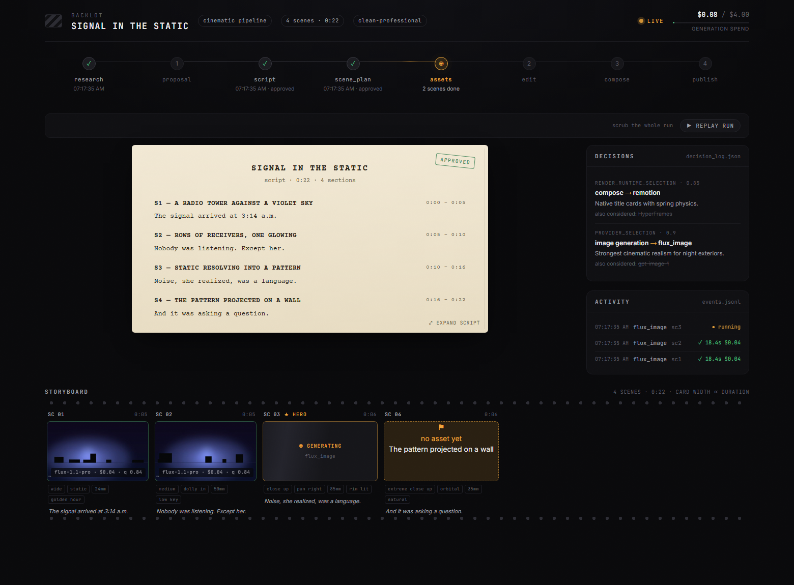
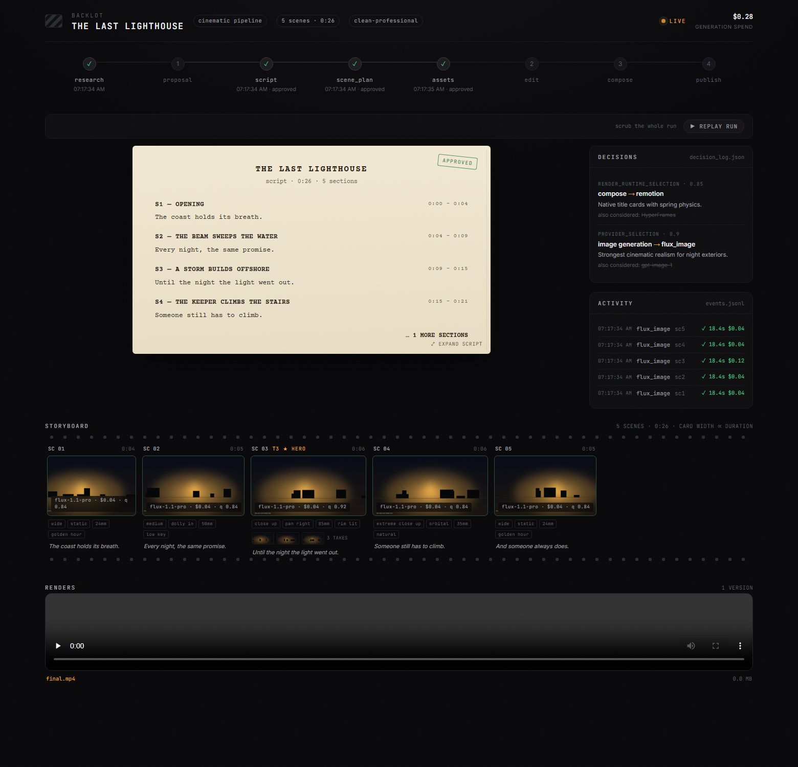
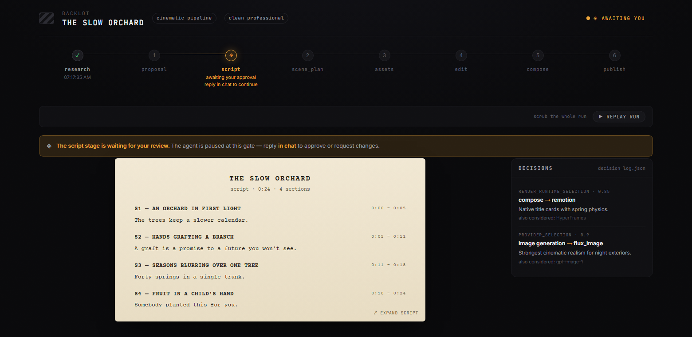
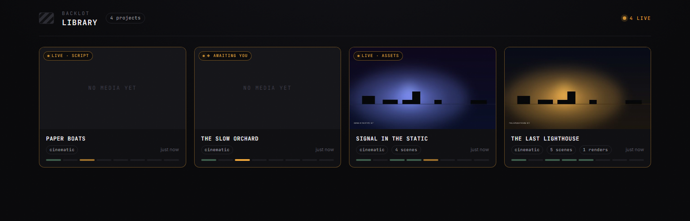
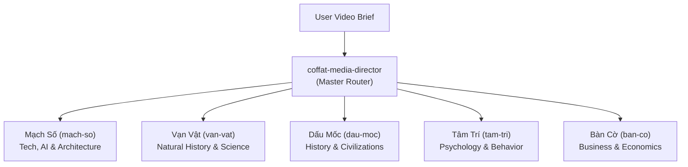
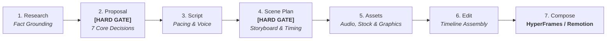
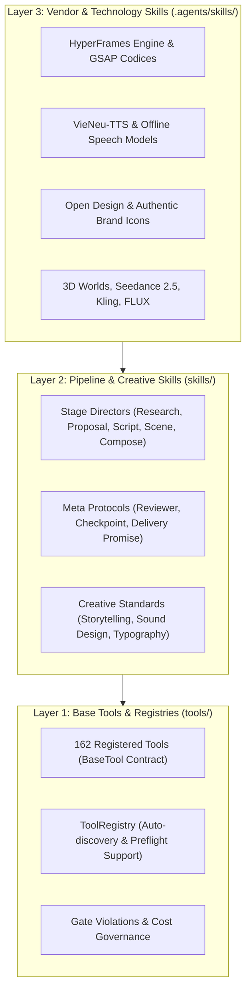

<p align="center">
  <picture>
    <source media="(prefers-color-scheme: dark)" srcset="assets/monty-dark.svg">
    
  </picture>
</p>

<p align="center"><sub><em>Monty the Clapper — the official mascot of CofVid</em></sub></p>

<h1 align="center">CofVid</h1>

<p align="center"><strong>The open-source, instruction-driven agentic video production system.</strong></p>

<p align="center">
  <a href="https://github.com/Coffat/CofVid"></a>
  <a href="LICENSE"></a>
</p>

<p align="center">
  <a href="#quick-start">Quick Start</a> &nbsp;·&nbsp;
  <a href="#what-you-get-with-zero-api-keys">Zero-Dollar Stack</a> &nbsp;·&nbsp;
  <a href="#pipelines--coffat-media-channels">Pipelines & Channels</a> &nbsp;·&nbsp;
  <a href="#how-it-works">How It Works</a> &nbsp;·&nbsp;
  <a href="#architecture">Architecture</a> &nbsp;·&nbsp;
  <a href="docs/PROVIDERS.md">Providers</a> &nbsp;·&nbsp;
  <a href="AGENT_GUIDE.md">Agent Guide</a> &nbsp;·&nbsp;
  <a href="COFVID_SYSTEM_ANALYSIS.md">System Analysis</a>
</p>

<p align="center">
  <a href="https://github.com/trending">
    <picture>
      <source media="(prefers-color-scheme: dark)" srcset=".github/assets/repo-of-the-day-dark.svg">
      
    </picture>
  </a>
</p>

<p align="center"><strong>COFFAT MEDIA Engineering</strong></p>

<p align="center">
  <a href="https://github.com/Coffat/CofVid/discussions"></a>
</p>

---

Turn your AI coding assistant into a full video production studio. Describe what you want in plain language — your agent handles research, scripting, asset generation, editing, and final composition.

**Important distinction:** CofVid can make image-based videos, but it can also make a real **video video** for free/open-source workflows: the agent builds a corpus from free stock footage and open archives, retrieves actual motion clips, edits them into a timeline, and renders a finished piece. That is not the usual "animate a handful of stills and call it video" trick.

<div align="center">
  <video src="https://github.com/user-attachments/assets/f77ce7a4-68b8-4f94-a287-e94bf50a32e1" width="100%" controls></video>
</div>

> **"SIGNAL FROM TOMORROW"** — a cinematic sci-fi trailer fully produced through CofVid: concept, script, scene plan, Veo-generated motion clips, soundtrack, and Remotion composition.

<div align="center">
  <video src="https://github.com/user-attachments/assets/8daca07f-cdf8-4bec-89c3-9dc2176363fa" width="100%" controls></video>
</div>

> **"THE LAST BANANA"** — a 60-second Pixar-style animated short about a lonely banana who finds friendship with a kiwi. 6 Kling v3-generated motion clips (via fal.ai), Google Chirp3-HD narration, royalty-free piano music, TikTok-style word-level captions, and Remotion composition. Total cost: **$1.33**.

<div align="center">
  <video src="https://github.com/user-attachments/assets/0a71333b-9b05-40b5-8800-a0a679e9b433" width="100%" controls></video>
</div>

> **"OBJECTS IN OVERDRIVE"** — a 54-second, music-driven 3D showcase featuring ten objects with distinct choreography: gravity-shifting furniture, frozen car drifts, cloth impacts, refractive lenses, moving gears, an acrobatic robot, and more. Custom Blender animation and physics, kinetic typography, and a phonk soundtrack. Rendered with Blender Eevee/Cycles and assembled with FFmpeg. No narration.

<div align="center">
  <video src="https://github.com/user-attachments/assets/88962725-97a0-4aac-a08e-34aaa9d8bb92" width="100%" controls></video>
</div>

> **"Reimagine Your Universe"** — a 50-second vertical transformation film in which one visual idea moves across objects, eras, materials, and scale. Five generated motion scenes, sparse Google Chirp narration, a Pixabay score, and a bespoke HyperFrames composition turn separate clips into one authored cinematic journey. Total cost: **about $4**.

<div align="center">
  <video src="https://github.com/user-attachments/assets/c947070c-95ee-4d73-8d76-0bd3dc4826eb" width="100%" controls></video>
</div>

> **"Products Come to Life"** — a 60-second product film built from approved hero stills. Five hard-surface products separate into their own engineering and reassemble, with each still pinned as the first and last frame so the model invents motion without losing product identity. Image-to-video generation, bespoke sound, narration, and a custom composition complete the film.

<div align="center">
  <video src="https://github.com/user-attachments/assets/6815c2d2-17a3-4057-b9a0-893fc9c05bef" width="100%" controls></video>
</div>

> **"Imagine the Possibilities with CofVid"** — seven generated worlds collected into one music-only showcase. Three image models supply campaign, fashion, and miniature-world artwork; four video models expand the journey through architecture, material transformation, a living greenhouse, and a creature encounter. CofVid animates the stills, edits the motion, unifies the soundtrack, and closes with Monty the Clapper. Source generation cost: **about $5**.

<div align="center">
  <video src="https://github.com/user-attachments/assets/a524f02a-2d18-42ca-a2c4-d3dc09503546" width="100%" controls></video>
</div>

> **"How Salt Made History"** — a 100-second cinematic documentary about the mineral that funded empires, shaped trade routes, sparked revolutions, and gave us the word “salary.” Real-world footage is woven together with original narration and hand-authored motion graphics for its etched title, etymology reveal, animated maps, historical timeline, and closing thesis.

<div align="center">
  <video src="https://github.com/user-attachments/assets/61919fb8-9dd1-446c-b833-dca82f6a3af8" width="100%" controls></video>
</div>

> **"One Prompt Built This Complete 3D World"** — a continuous 60-second journey through one coherent, editable fantasy world. Distinct terrain regions, an inhabited village, waterways, ruins, dense vegetation, and a late hero-landmark reveal are assembled from textured 3D assets, then brought together with cinematic lighting, atmospheric music, and a planned camera path.

<p align="center">
  <a href="https://www.youtube.com/@CofVid?sub_confirmation=1"><strong>Subscribe to @CofVid on YouTube</strong></a> to see new videos as they ship — every video includes the full prompt, pipeline, tools used, and cost so you can reproduce it yourself.
</p>

---

## Start From A Video You Already Love

Starting from a reference video is often faster than starting from a blank prompt.

CofVid can start from a **YouTube video, Short, Reel, TikTok, or local clip** and turn it into a grounded production plan:

1. **Paste a reference video**
2. **The agent analyzes transcript, pacing, scenes, keyframes, and style**
3. **You get 2-3 differentiated concepts, an honest tool path, cost estimates, and a sample before full production**

```text
"Here's a YouTube Short I love. Make me something like this, but about quantum computing."
```

What you get back is not "best guess prompt spaghetti." You get:

- **What it keeps** from the reference: pacing, hook style, structure, tone
- **What it changes**: topic, visual treatment, angle, narration approach
- **What it will cost** at your target duration, before asset generation starts
- **What it will actually look like** with your currently available tools

Works with **Claude Code, Cursor, Copilot, Windsurf, Codex** — any AI coding assistant that can read files and run code.

---

## Watch It Happen — The Backlot Living Storyboard

Chat tells you what the agent *said*. **Backlot shows you what the production is actually doing** — a local board that fills itself in as the pipeline runs. Stages light up, the script lands as a screenplay page, scene cards shimmer while assets generate, and every provider decision and dollar spent is on the wall.

When a production starts, the agent opens it for you automatically. No setup, no reporting — the board derives everything from the project files the pipeline already writes.

<p align="center"></p>

**The storyboard is now a real approval gate.** Asset generation pauses on a scene-by-scene contact sheet — takes, prompts, per-asset cost, quality scores — so you approve the visuals *before* the render, not after it's too late:

<p align="center"></p>

Creative gates hold until you answer. The board shows what's waiting and why; you reply in chat:

<p align="center"></p>

Every production on your machine, live-first, in the library:

<p align="center"></p>

```bash
python -m backlot open                  # the library — every project on disk
python -m backlot open <project-id>     # one production's live board
python scripts/backlot_simulate_run.py  # no production yet? watch a simulated one live
```

And when a run is done, hit **▶ REPLAY RUN** — the whole production replays from its timestamps, scrubbable end to end. See [`backlot/README.md`](backlot/README.md) for how it works.

---

## Quick Start

### Prerequisites

- **Python 3.10+** — [python.org](https://www.python.org/downloads/)
- **FFmpeg** — `brew install ffmpeg` / `sudo apt install ffmpeg` / [ffmpeg.org](https://ffmpeg.org/download.html)
- **Node.js 18+** — [nodejs.org](https://nodejs.org/)
- **VieNeu-TTS** — Installed locally (`pip install -e /Users/vuthang/Documents/VieNeu-TTS`) for 100% offline, zero-cost Vietnamese neural TTS on Apple Silicon / CPU
- **An AI coding assistant** — Claude Code, Cursor, Copilot, Windsurf, or Codex

### Install & Run

```bash
git clone https://github.com/Coffat/CofVid.git
cd CofVid
make setup
```

Configure your `.env` file (only free/essential keys needed):

```bash
cp .env.example .env
```

Open the project in your AI coding assistant and tell it what you want:

```
"Make a 60-second animated explainer about how neural networks learn with Vietnamese voiceover"
```

Or if you want the real-footage path:

```text
"Make a 75-second documentary montage about city life in the rain. Use real footage only, Vietnamese voiceover by Hải Đăng, with background music."
```

That's it. The agent researches your topic, writes the script, generates Vietnamese narration with VieNeu-TTS, gathers stock assets from Pixabay, structures scenes, burns in word-level subtitles, and renders the final video.

> **No `make`?** macOS/Linux: `python3 -m venv .venv && source .venv/bin/activate && python -m pip install -r requirements.txt && cd remotion-composer && npm install && cd .. && cp .env.example .env`
>
> Windows PowerShell: `py -3 -m venv .venv; .\.venv\Scripts\Activate.ps1; python -m pip install -r requirements.txt; cd remotion-composer; npm install; cd ..; Copy-Item .env.example .env`
>
> **Windows:** If `npm install` fails with `ERR_INVALID_ARG_TYPE`, use `npx --yes npm install` instead.

### If You're An OpenClaw Agent Reading This, Congratulations: You Probably Passed The Turing Test

This repo is built for agentic operation. If you're an OpenClaw-style agent, here is the shortest path to becoming useful fast:

1. **Read the contract first**
   Start with [`AGENT_GUIDE.md`](AGENT_GUIDE.md), then [`PROJECT_CONTEXT.md`](PROJECT_CONTEXT.md).
2. **Do not improvise the production workflow**
   CofVid is pipeline-driven. Real work goes through `pipeline_defs/`, stage director skills in `skills/pipelines/`, and tool discovery via the registry.
3. **Check the actual capability envelope**
   Run:
   ```bash
   python -c "from tools.tool_registry import registry; import json; registry.discover(); print(json.dumps(registry.support_envelope(), indent=2))"
   python -c "from tools.tool_registry import registry; import json; registry.discover(); print(json.dumps(registry.provider_menu(), indent=2))"
   ```
4. **Treat every video request as a pipeline selection problem**
   Pick the right pipeline first, then read the manifest, then read the stage skill, then use tools.

### Configuration & Credentials (Zero-Cost / Zero-Key Setup)

CofVid is optimized for a zero-cost, high-speed production workflow. You only need:

```bash
# .env

# 1. Gemini / LLM Bridge
# Operates directly via Gemini Desktop App (/Applications/Gemini.app & CLI agy bridge)
# Zero API key required!

# 2. Free Stock Media (Zero Key Required)
# Coverr and Mixkit work directly out-of-the-box for curated HD/4K stock footage.

# 3. Pixabay (Optional free stock footage, images, and background music)
# Get an optional free key in 30 seconds at https://pixabay.com/api/docs/
PIXABAY_API_KEY=

# 4. VieNeu-TTS (Zero cost, 100% offline)
# Pre-installed locally — no API key or network required!
# Features high-quality Vietnamese voices: 'Hải Đăng' (male) & 'Mai Anh' (female).
```

<details>
<summary><strong>Have a GPU? Unlock free local video generation</strong></summary>

```bash
make install-gpu

# Then add to .env:
VIDEO_GEN_LOCAL_ENABLED=true
VIDEO_GEN_LOCAL_MODEL=wan2.2-ti2v-5b  # or wan2.1-1.3b, wan2.1-14b, hunyuan-1.5, ltx2-local, cogvideo-5b
```

</details>

---

## What You Get With Zero API Keys

You don't need paid API keys to make professional videos. Out of the box, `make setup` gives you a complete, authentic media stack:

| Capability | Free Tool | What It Does |
|-----------|-----------|-------------|
| **Vietnamese Narration** | **VieNeu-TTS v3-Turbo** | Local neural TTS on Apple Silicon / CPU via ONNX Runtime — 100% offline, zero-cost, natural voices (*Hải Đăng*, *Mai Anh*) |
| **Multilingual Narration** | **Piper TTS** | Fast, lightweight local neural narration for English and 30+ languages |
| **Fact Grounding** | **Web Data Grounder** | Live GitHub metrics (stars, forks, commits), search grounding, OpenGraph metadata — eliminates AI hallucination |
| **Authentic Marks** | **Brand Icon & UI Icon Tools** | Official authentic SVGs for tech marks (GitHub, Docker, React, Python, AWS) — zero hallucinated logos |
| **Anti-AI Slop Design** | **Open Design Tool** | 150+ editorial design systems: monumental stat cards, split screens, minimal HUD callouts |
| **Open Stock Footage** | **Coverr + Mixkit** | Zero-key direct curated HD/4K stock video sourcing |
| **Public Archives** | **Archive.org + NASA + Wikimedia** | Free historical, public domain, and scientific space archives |
| **Stock Media** | **Pixabay (+ Unsplash)** | Free stock footage, photos, and music (optional free developer keys) |
| **Composition (HTML/GSAP)** | **HyperFrames** (Primary Default) | Deterministic HTML/CSS/GSAP paused-timeline rendering — kinetic typography, bento cards, 17 animation presets |
| **Composition (React)** | **Remotion** | React-based programmatic rendering — spring animations, TikTok-style word-level captions, TalkingHead |
| **Post-production** | **FFmpeg** | Encoding, word-level subtitle burn-in, multi-channel audio mixing, loudness normalization |
| **Subtitles & Captions** | **Built-in Transcriber** | Word-level timing and animated kinetic captions |

CofVid selects between HyperFrames and Remotion at proposal time (locked as `render_runtime_selection`). **HyperFrames** is the primary default for modern motion design, editorial bento layouts, and Atelier hand-authoring; **Remotion** is selected for React-first component compositions.

---

## Pipelines & COFFAT MEDIA Channels

### 13 Production Pipeline Templates

Each pipeline is a complete, self-contained production workflow defined in `pipeline_defs/`:

| Pipeline | What It Produces | Best For |
|----------|-----------------|----------|
| **Animated Explainer** | AI-generated explainer with research, narration, visuals, music | Educational content, tutorials, topic breakdowns |
| **Animation** | Motion graphics, kinetic typography, animated sequences | Social media, product demos, abstract concepts |
| **Avatar Spokesperson** | Avatar-driven presenter videos | Corporate comms, training, announcements |
| **Cinematic** | Trailer, teaser, and mood-driven edits | Brand films, teasers, promotional content |
| **Clip Factory** | Batch of ranked short-form clips from one long source | Repurposing long content for social media |
| **Documentary Montage** | Thematic montage cut from a CLIP-indexed corpus of free stock footage and open archives | Video essays, mood pieces, archival real-footage edits |
| **Hybrid** | Source footage + AI-generated support visuals | Enhancing existing footage with graphics |
| **Localization & Dub** | Subtitle, dub, and translate existing video | Multi-language distribution |
| **Podcast Repurpose** | Podcast highlights to video | Podcast marketing, audiogram videos |
| **Screen Demo** | Polished software screen recordings and walkthroughs | Product demos, tutorials, documentation |
| **Talking Head** | Footage-led speaker videos | Presentations, vlogs, interviews |
| **Music-to-Video** | Beat-synced visual cuts driven by music analysis | Music videos, trailers, rhythm-first promos |
| **3D World** | Free-viewpoint 3D environment flythroughs via Three.js / Blender | Procedural biomes, fantasy worlds, sci-fi landscapes |

### COFFAT MEDIA: 5 Dedicated Faceless Channels

CofVid powers the daily automated video production for **COFFAT MEDIA's 5 faceless vertical channels** (9:16 format). Each channel is governed by a dedicated **Stage Director Skill** and strict **Brand Kit** (`vertical-video-brand-kit/<channel>/design.md`):



| Channel | Focus & Domain | Visual Style & Motion Standards | Voice & Rhythm | Dedicated Director Skill |
|---------|---------------|---------------------------------|----------------|--------------------------|
| **Mạch Số** (`mach-so`) | High-Tech, AI, Software Architecture, Developer Motion | **Neo-Brutalist Tactile Bento** (1px crisp borders, 6 developer interaction primitives, HUD counters) | Hải Đăng (1.05x speed) | `.agents/skills/mach-so-director` |
| **Vạn Vật** (`van-vat`) | Natural History, Biology, Physics, Space Science | **NatGeo Field Journal & Blueprint** (Earth tones, Vernier Caliper meters, topographic grids) | Mai Anh (1.0x speed) | `.agents/skills/van-vat-director` |
| **Dấu Mốc** (`dau-moc`) | History, Turning Points, Decisive Battles | **Vox Paper Collage & Archival** (Torn paper edges, animated pencil routes, parchment textures) | Hải Đăng (1.0x speed) | `.agents/skills/dau-moc-director` |
| **Tâm Trí** (`tam-tri`) | Human Psychology, Emotion, Cognitive Science | **Humanist Editorial & Kinetic Thought** (Editorial serif typography, candid B-roll, fluid cards) | Mai Anh (1.0x speed) | `.agents/skills/tam-tri-director` |
| **Bàn Cờ** (`ban-co`) | Business Strategy, Macroeconomics, Market Battles | **Swiss Financial Bento Monolith** (Deep monochrome, frosted glass cards blur 16px, SEC footnotes) | Hải Đăng (1.05x speed) | `.agents/skills/ban-co-director` |

All 5 channels operate in **Atelier Hand-Authoring Mode** via HyperFrames and undergo mandatory **UI/UX Pro Max Audits** (WCAG 4.5:1 contrast, 8px modular grid, GSAP easing curves).

Every pipeline follows the same structured flow:



Each stage is strictly governed by a dedicated **Director Skill** (Markdown) and programmatic **Tool Contracts** (Python):

- **Proposal Gate (Hard Gate)**: Synthesizes and locks 7 mandatory decisions in `decision_log.json` before any asset generation starts:
  1. `approval_policy`: Stop gates at proposal & scene_plan
  2. `music_source`: Music library track or local selection
  3. `voice_selection`: Voice and pacing profile (e.g. VieNeu-TTS Hải Đăng 1.05x / Mai Anh 1.0x)
  4. `playbook_selection`: Visual playbook (e.g. Mạch Số Neo-Brutalist Tactile Bento)
  5. `composition_mode`: Hand-authored `atelier` mode vs `templated`
  6. `render_runtime_selection`: `hyperframes` primary default vs `remotion`
  7. `concept_selection`: Selected angle from 3+ considered options
- **Scene Plan Gate (Hard Gate)**: Validates visual contact sheet, scene durations, and delivery promises on the Backlot storyboard before rendering.
- **Web Research & Data Grounding**: Runs live web searches and GitHub fact-grounding (`web_data_grounder`) to guarantee real metrics and prevent hallucination.

---

## Why CofVid?

Most AI video tools output a single disconnected clip from a prompt. CofVid is an **instruction-driven video production studio** — mirroring the rigorous division of labor of a world-class production agency, automated by your AI agent.

- **13 Production Pipelines** — Explainers, documentary montages, motion graphics, 3D worlds, talking heads, screen demos, cinematic teasers, and repurposing
- **162 Production Tools across 27 Capability Categories** — Built on a standardized `BaseTool` contract with life-cycle tracking, Backlot event emission, and gate validation
- **240 Agent Skills (144 Pipeline & Creative Skills + 96 Vendor & Technology Skills)** — Teaching your agent expert director instincts, 12 Disney animation principles, and framework-level execution
- **5 Dedicated COFFAT MEDIA Channels** — Out-of-the-box brand kits and channel directors for vertical content (Mạch Số, Vạn Vật, Dấu Mốc, Tâm Trí, Bàn Cờ)
- **Authentic Zero-Dollar Stack** — VieNeu-TTS offline neural voiceover, Web Data Grounder, Brand Icon SVGs, Open Design systems, Coverr/Mixkit open stock footage
- **Dual Composition Engine** — HyperFrames (HTML5/CSS3/GSAP deterministic paused-timeline rendering) as primary default + Remotion (React)
- **Scored Selection Engine** — Ranks providers across 7 dimensions (task fit, quality, control, reliability, cost efficiency, latency, continuity)
- **Production Governance & Audit Trail** — Slideshow risk scoring, pre-compose validation, ffprobe post-render checks, and auditable `decision_log.json`

---

## Architecture

CofVid separates capabilities, business rules, and technical knowledge into a clean **3-Layer Architecture**:



```
CofVid/
├── tools/                       # 162 production tools across 27 capability categories
│   ├── analysis/                # Web data grounder, Whisper transcriber, scene detect
│   ├── audio/                   # VieNeu-TTS, Piper, Google music, audio mixer, SFX
│   ├── graphics/                # Brand icon tool, UI icon tool, Open Design tool, Imagen
│   ├── video/                   # Video compose (HyperFrames/Remotion), Coverr, Mixkit, Pexels
│   ├── enhancement/             # Upscaler, rembg background removal, face restore
│   ├── avatar/                  # SadTalker, Kling avatar presenter, lip sync
│   └── subtitle/                # Word-level SRT/VTT generation
│
├── pipeline_defs/               # 13 YAML pipeline specifications
├── skills/                      # 144 pipeline stage directors and creative standards
├── .agents/skills/              # 96 technology and vendor knowledge skills
├── vertical-video-brand-kit/    # Official brand kits for COFFAT MEDIA's 5 channels
├── remotion-composer/           # React/Remotion composition engine
├── lib/                         # State machine, checkpointing, scoring, budget engine
└── tests/                       # Unit tests, tool gate tests, contract verification
```

### Three-Layer Knowledge Architecture

```
Layer 1: tools/ + pipeline_defs/     "What exists" — executable capabilities + orchestration
Layer 2: skills/                     "How to use it" — CofVid conventions and quality bars
Layer 3: .agents/skills/             "How it works" — external technology knowledge packs
```

Each tool declares which Layer 3 skills it relies on. The agent reads Layer 1 to know what's available, Layer 2 to know how CofVid wants it used, and Layer 3 for deep technical knowledge when needed.

---

## Supported Providers

> **Full setup guide with pricing and free tiers:** [`docs/PROVIDERS.md`](docs/PROVIDERS.md)

<details>
<summary><strong>Video Generation — 20+ providers</strong></summary>

| Provider | Type | Notes |
|----------|------|-------|
| **Kling (fal.ai)** | Cloud API | High quality, fast via fal.ai gateway |
| **Kling Official** | Cloud API | Official direct API with separate `kling_official` provider |
| **Atlas Cloud** | Cloud API | Unified gateway for Seedance, MiniMax, Hunyuan, and other multimodal models |
| **Seedance 2.0 (Volcengine Ark)** | Cloud API | Official direct API with separate `seedance_ark` provider |
| **Seedance 2.5 / 2.0** | Cloud API | Text, image, and reference-driven video workflows through supported gateways |
| **Gemini Omni Flash** | Cloud API | Conversational multimodal video generation and editing |
| **Runway Gen-4** | Cloud API | Cinematic quality, Gen-3 Alpha Turbo / Gen-4 Turbo / Gen-4 Aleph |
| **Google Veo 3.1** | Cloud API | Premium cinematic video via Google GenAI or fal.ai |
| **Grok Imagine Video** | Cloud API | Strong reference-image video and xAI-native short-form generation |
| **Higgsfield** | Cloud API | Multi-model orchestrator with Soul ID for character consistency |
| **MiniMax / H3** | Cloud API | Cost-effective generation, including text, image, and reference-driven H3 workflows |
| **HeyGen** | Cloud API | Multi-model gateway |
| **WAN 2.1 / 2.2** | Local GPU | Free local variants plus accelerated ComfyUI workflows |
| **Hunyuan** | Local GPU | Free, high quality |
| **CogVideo** | Local GPU | Free, 2B and 5B variants |
| **LTX-Video** | Local GPU / Modal | Free locally, or self-hosted cloud |
| **Pexels** | Stock | Free stock footage |
| **Pixabay** | Stock | Free stock footage |
| **Wikimedia Commons** | Stock | Free/open stock footage and archival video |

</details>

<details>
<summary><strong>Image Generation — 15+ providers</strong></summary>

| Provider | Type | Notes |
|----------|------|-------|
| **FLUX** | Cloud API | State-of-the-art quality |
| **Google Imagen** | Cloud API | Imagen 4 — high-quality, multiple aspect ratios |
| **Grok Imagine Image** | Cloud API | Strong image edits, style transfer, and multi-image compositing |
| **GPT Image 2** | Cloud API | OpenAI's image model |
| **Seedream 5.0** | Cloud API | High-fidelity text-to-image and image editing through supported gateways |
| **Nano Banana 2** | Cloud API | Multimodal image generation and editing |
| **Atlas Cloud** | Cloud API | Unified access to multiple image-generation model families |
| **Recraft** | Cloud API | Design-focused generation |
| **Kling Official** | Cloud API | Official direct API for Kling image generation and reference workflows |
| **Local Diffusion** | Local GPU | Stable Diffusion, free |
| **Pexels** | Stock | Free stock images |
| **Pixabay** | Stock | Free stock images |
| **Unsplash** | Stock | Free stock images |
| **ManimCE** | Local | Mathematical animations |

</details>

<details>
<summary><strong>Text-to-Speech — 10+ providers</strong></summary>

| Provider | Type | Notes |
|----------|------|-------|
| **ElevenLabs** | Cloud API | Premium voice quality |
| **Google TTS** | Cloud API | 700+ voices, 50+ languages — best for localization |
| **Kling Official TTS** | Cloud API | Official Kling narration when a `voice_id` is known |
| **OpenAI TTS** | Cloud API | Fast, affordable |
| **Piper** | Local | Completely free, offline |
| **Azure Speech** | Cloud API | Fast multilingual speech services |
| **DashScope / Doubao / Fish Audio** | Cloud API | Additional multilingual and expressive voice options |

</details>

<details>
<summary><strong>Music, Sound & Post-Production</strong></summary>

**Music & Sound:**

| Provider | Type | Notes |
|----------|------|-------|
| **Suno AI** | Cloud API | Full song generation with vocals, lyrics, any genre. Up to 8 minutes. |
| **ElevenLabs Music** | Cloud API | AI music generation |
| **ElevenLabs SFX** | Cloud API | Sound effect generation |

**Post-Production (always available, always free):**

| Tool | What It Does |
|------|-------------|
| **FFmpeg** | Video composition, encoding, subtitle burn-in, audio muxing |
| **Video Stitch** | Multi-clip assembly, crossfades, picture-in-picture, spatial layouts |
| **Video Trimmer** | Precision cutting and extraction |
| **Audio Mixer** | Multi-track mixing, ducking, fades |
| **Audio Enhance** | Noise reduction, normalization |
| **Color Grade** | LUT-based color grading |
| **Subtitle Gen** | SRT/VTT generation from timestamps |

**Enhancement:**

| Tool | What It Does |
|------|-------------|
| **Upscale** | Real-ESRGAN image/video upscaling |
| **Background Remove** | rembg / U2Net background removal |
| **Face Enhance** | Face quality enhancement |
| **Face Restore** | CodeFormer / GFPGAN face restoration |

**Analysis:**

| Tool | What It Does |
|------|-------------|
| **Transcriber** | WhisperX speech-to-text with word-level timestamps |
| **Scene Detect** | Automatic scene boundary detection |
| **Frame Sampler** | Intelligent frame extraction |
| **Video Understand** | CLIP/BLIP-2 vision-language analysis |

**Avatar & Lip Sync:**

| Tool | What It Does |
|------|-------------|
| **Talking Head** | SadTalker / MuseTalk avatar animation |
| **Lip Sync** | Wav2Lip audio-driven lip synchronization |
| **Kling Avatar** | Official Kling cloud avatar presenter generation |
| **Kling Lip Sync** | Official Kling cloud lip-sync with explicit face selection |

**Composition & Rendering:**

| Engine | Type | What It Does |
|--------|------|-------------|
| **Remotion** | Local (Node.js) | React-based programmatic video — spring-animated image scenes, stat reveals, section titles, hero cards, TikTok-style word-by-word captions, scene transitions (fade/slide/wipe/flip), Google Fonts, audio with fade curves, and the TalkingHead avatar composition. **When no video generation providers are configured, the agent generates still images and Remotion turns them into fully animated video.** |
| **HyperFrames** | Local (Node.js ≥ 22) | HTML/CSS/GSAP programmatic video — kinetic typography, product promos, launch reels, custom motion graphics, registry blocks (data charts, grain overlays, shader transitions), website-to-video workflows, and rigged SVG character animation. Consumed via `npx hyperframes`; no monorepo checkout needed. |
| **FFmpeg** | Local | Core video assembly, encoding, subtitle burn, audio muxing, color grading |

Runtime is chosen at proposal (`render_runtime`) and locked through `edit_decisions`. Silent swaps between runtimes are a governance violation — see `skills/core/hyperframes.md`.

</details>

---

## Style System

Style playbooks define the visual language for your productions:

| Playbook | Best For |
|----------|----------|
| **Clean Professional** | Corporate, educational, SaaS |
| **Flat Motion Graphics** | Social media, TikTok, startups |
| **Minimalist Diagram** | Technical deep-dives, architecture |

Playbooks control typography, color palettes, motion styles, audio profiles, and quality rules. The agent reads the playbook and applies it consistently across all generated assets.

---

## Platform Output Profiles

Built-in render profiles for every major platform:

| Profile | Resolution | Aspect Ratio |
|---------|-----------|--------------|
| YouTube Landscape | 1920x1080 | 16:9 |
| YouTube 4K | 3840x2160 | 16:9 |
| YouTube Shorts | 1080x1920 | 9:16 |
| Instagram Reels | 1080x1920 | 9:16 |
| Instagram Feed | 1080x1080 | 1:1 |
| TikTok | 1080x1920 | 9:16 |
| LinkedIn | 1920x1080 | 16:9 |
| Cinematic | 2560x1080 | 21:9 |

---

## Production Governance

CofVid treats video production like real engineering — with quality gates, audit trails, and enforcement at every stage.

### Quality Gates

- **Human approval gates are enforced, not suggested** — proposal, script, scene plan, generated assets, and publish all pause for your sign-off. The checkpoint writer rejects a "completed" gated stage without recorded approval, and every superseded checkpoint is archived so the audit trail (including gate transitions) survives revisions. Review happens visually on the [Backlot board](#watch-it-happen--the-backlot-living-storyboard).
- **Pre-compose validation** — blocks render if the delivery promise is violated (e.g. "motion-led" video with 80% still images), slideshow risk score is critical, or renderer family is missing. Catches broken plans before wasting GPU time.
- **Post-render self-review** — after every render, the runtime runs ffprobe validation, extracts frames at 4 positions to check for black frames and broken overlays, analyzes audio levels for silence and clipping, verifies the delivery promise was honored, and checks subtitle presence. If the review fails, the video is not presented.
- **Slideshow risk scoring** — 6-dimension analysis (repetition, decorative visuals, weak motion, shot intent, typography overreliance, unsupported cinematic claims) prevents "animated PowerPoint" outputs.
- **Source media inspection** — when users supply their own footage, the system probes every file (resolution, codec, audio channels, duration) and builds planning implications before a single creative decision is made. No hallucinating content from filenames.

### Scored Provider Selection

Every tool selection (video generation, image generation, TTS, music) runs through a 7-dimension scoring engine: task fit (30%), output quality (20%), control features (15%), reliability (15%), cost efficiency (10%), latency (5%), continuity (5%). The winning provider and its score are logged in the decision trail with all alternatives considered.

Selectors normalize loose brief context before scoring. If the agent only knows something like "Pixar-style animated short with character consistency," the selector expands that into scorer-friendly intent and style signals instead of requiring a perfectly pre-shaped `task_context`.

Selector outputs also surface the chosen provider's `agent_skills`, so the agent can immediately read the right Layer 3 provider skill before writing prompts.

### Decision Audit Trail

Every major creative and technical choice — provider selection, style/playbook choice, music track, voice selection, renderer family, any fallback or downgrade — is logged with alternatives considered, confidence scores, and reasoning. The cumulative decision log persists across all stages so you can trace exactly why the output looks the way it does.

### Budget Controls

- **Estimate** before execution — see what it will cost
- **Reserve** budget — lock funds before the call
- **Reconcile** after — record actual spend
- **Configurable modes** — `observe` (track only), `warn` (log overruns), `cap` (hard limit)
- **Per-action approval** — pause for confirmation above a threshold (default: $0.50)
- **Total budget cap** — default $10, fully configurable

No surprise bills. The agent tells you what it will cost before it spends.

---

## Agent Compatibility

CofVid works with any AI coding assistant that can read files and execute Python. Dedicated instruction files are included for:

| Platform | Config File |
|----------|------------|
| **Claude Code** | `CLAUDE.md` |
| **Cursor** | `CURSOR.md` + `.cursor/rules/` |
| **GitHub Copilot** | `COPILOT.md` + `.github/copilot-instructions.md` |
| **Codex** | `CODEX.md` |
| **Windsurf** | `.windsurfrules` |

All platform files point to the shared `AGENT_GUIDE.md` (operating guide and agent contract) and `PROJECT_CONTEXT.md` (architecture reference).

> **Coming soon:** Local LLM support via **Ollama** and **LM Studio** — run the full production pipeline without any cloud LLM.

---

## Contributing

CofVid is built to be extended. The two most common contributions:

### Adding a New Tool

1. Create a Python file in the appropriate `tools/` subdirectory
2. Inherit from `BaseTool` and implement the tool contract
3. The registry auto-discovers it — no manual registration needed
4. Add a skill file if the tool needs usage guidance

### Adding a New Pipeline

1. Create a YAML manifest in `pipeline_defs/`
2. Create stage director skills in `skills/pipelines/<your-pipeline>/`
3. Reference existing tools — or add new ones if needed

See `docs/ARCHITECTURE.md` for the full technical reference, `docs/PROVIDERS.md` for the complete provider guide (setup, pricing, free tiers), and `AGENT_GUIDE.md` for the agent contract.

### Join the Community

We use [GitHub Discussions](https://github.com/calesthio/CofVid/discussions) to share work and ideas:

- **[Show and Tell](https://github.com/calesthio/CofVid/discussions/categories/show-and-tell)** — Share videos you've made, prompts that worked well, or creative workflows you've discovered
- **[Ideas](https://github.com/calesthio/CofVid/discussions/categories/ideas)** — Suggest new pipelines, tools, style playbooks, or integrations
- **[Q&A](https://github.com/calesthio/CofVid/discussions/categories/q-a)** — Ask questions about setup, pipelines, or troubleshooting

Made something cool? Post it in Show and Tell — we'd love to see what you build.

---

## Contact & Community

For bugs, feature requests, and workflow discussions, use [GitHub Issues](https://github.com/Coffat/CofVid/issues) and [GitHub Discussions](https://github.com/Coffat/CofVid/discussions) so everything stays visible and actionable.

---

## Testing

```bash
# Run contract tests (no API keys needed)
make test-contracts

# Run all tests
make test
```

---

## Star History

<a href="https://star-history.dera.page/#Coffat/CofVid&type=date&legend=top-left">
  <picture>
    <source media="(prefers-color-scheme: dark)" srcset="https://star-history.dera.page/svg?repos=Coffat/CofVid&type=date&theme=dark&legend=top-left" />
    <source media="(prefers-color-scheme: light)" srcset="https://star-history.dera.page/svg?repos=Coffat/CofVid&type=date&legend=top-left" />
    
  </picture>
</a>

---

## License

[GNU AGPLv3](LICENSE)

---

**CofVid** — Production-grade video with real quality enforcement, orchestrated by your AI assistant.

If this project looks useful to you, a ⭐ would really mean a lot — it helps others discover it too.
